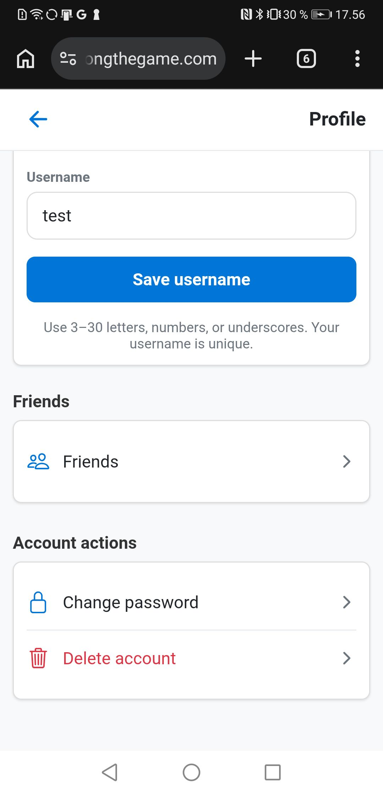
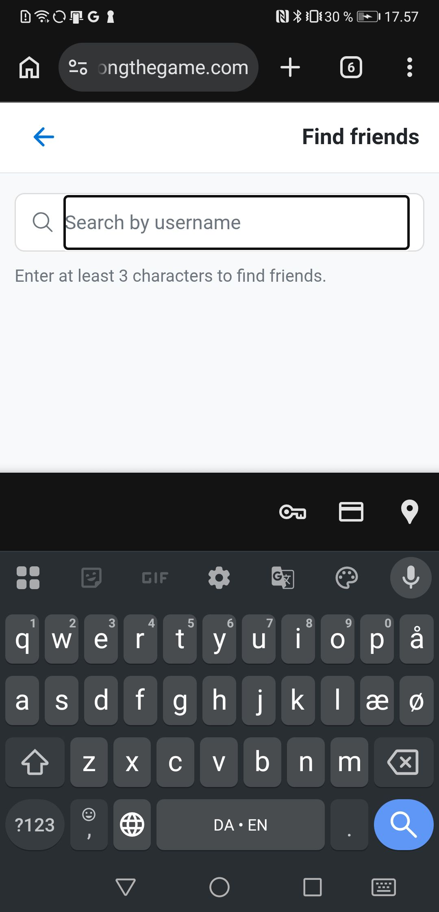

# DONG navigation audit — web and Android

Date: 2026-10-16. Local source commit: `3750010`.

Status: initial audit completed, including physical Android Chrome and Expo Android checks after the user granted exclusive device access. This extends [the mobile web UX audit](mobile-web-ux-audit-2026-10-16.md) into gameplay, lobbies, Friends, and History. Product code is unchanged. Native iOS release work is out of scope. Untested room lifecycle paths are listed explicitly below; this report is not full release acceptance.

## Evidence and coverage

- **Source-confirmed:** navigation behavior follows directly from the current code. Native/runtime impact is not implied unless reproduced.
- **Browser-confirmed:** observed on deployed `dongthegame.com` in the desktop in-app browser. This does not establish physical Android behavior or the deployed commit.
- **Device-confirmed:** observed on the physical target, with platform and state identified.
- **Unverified:** blocked by authentication, absent data, unavailable device/build, or an unexplored state.

| Area | Source review | Browser walkthrough | Physical device |
| --- | --- | --- | --- |
| Gameplay | Actions sheet, Home/Setup destinations, context handling, tab state | Empty direct entry, sheet Back, Home destination, portrait/landscape action fit examined | Native populated game: Matches/Players, actions sheet and hardware Back; quick actions dismiss correctly |
| Lobbies | Wizard, enter-game transition, return-to-game, loading/auth recovery | Signed-out access gate and sign-in/return/Home navigation examined using a synthetic route target | Native existing owner/in-progress lobby inspected; hardware Back returns Home, re-entry works. Chrome Home has no active room |
| Friends | Entry, search, blocked list, tabs, shared-history destination | Signed-out direct entry and Back examined | Chrome: Requests, search/IME, Blocked, comparison and return. Native: Requests/search return and duplicate parent reproduced |
| History | Tabs, sort/details state, shared view, Back behavior | Empty history and Stats; refresh and fresh-tab Back examined | Chrome populated details and comparison scrolling; native populated details/sort and hardware Back examined |

Physical target: Huawei CLT-L29, Android 10, serial `WCR0218C11000221`. The initial restricted-shell device probe failed; checking ADB outside the sandbox restored visibility and ARTEMIS reported ready. Do not mistake that tooling problem for a DONG defect.

ARTEMIS mobile-web trace: `810e8fe7-eeab-4bea-a25f-389e4f45a618`. The autonomous run was cancelled after repeated provider 503/unavailable responses and an open retry circuit, before a task plan or useful walkthrough was produced. Credentials validated; this is not an application failure. ARTEMIS screen/hierarchy observation works. Targeted navigation continued through ADB, with UI hierarchy checks and screenshots. No relationships or server games were changed.

The installed `com.krogh.dong.dev` build (version 1.0.0, last updated 2026-09-26) initially showed the Expo development launcher. After starting Metro outside the restricted shell and using the USB reverse tunnel, the current repository bundle loaded. Native home showed an existing game with 1 player / 13 matches and 3 history games. These are existing user data, not audit fixtures.

## Initial findings

### N01 — P1 — Multiplayer Setup action switches to solo context

**Source-confirmed.** `hooks/useGameProgressController.ts:273`, `components/gameProgress/GameActionsSheet.tsx:146`, `app/gameProgress.tsx:155`.

The game actions sheet always offers **Setup**. Its handler clears active game context when multiplayer is active, then pushes `/setupGame`, which is the solo setup screen. It does not return to `/lobby/[sessionId]`. This can make the same roster/matches appear to be solo data while the server room membership remains elsewhere. No server-side departure or data loss is established by this finding.

Suggested correction: route registered multiplayer participants to their room configuration/status screen with permissions intact; define an explicit guest equivalent; retain solo setup navigation only for solo games. Returning to configuration must not silently change game mode. Avoid exercising this action against a real active room until its impact is controlled.

### N02 — P2 — History tabs and detail/sort state are not represented by the URL

**Browser-confirmed for Stats refresh; source-confirmed for other local state.** `app/history.tsx:79`, `app/history.tsx:199`, `app/history.tsx:245`, `app/history.tsx:274`.

Reproduction: open `/history`, select Stats, observe the URL remains `/history`, then refresh. It returns to Games. The `friendId` query can initialize a target, but subsequent in-page selection changes are local state. Details and sort are also held in the reducer rather than a route.

Suggested correction: put meaningful tabs, comparison targets and shareable game detail identity in web route/query state. Define Back and refresh behavior, validating access and unavailable data. Do not put private game payloads into URLs.

### N03 — P2 — Empty direct gameplay entry has no recovery explanation

**Browser-confirmed.** `app/gameProgress.tsx:89`.

Opening `/gameProgress` without an active game renders Matches 0 / Players 0 and mostly empty content. There is no visible “No active game” message or primary Start/Return Home action in the body. Recovery is hidden in the plus-icon Game actions menu. The sheet even offers End Game in this empty solo state; it was not pressed.

Suggested correction: show an intentional no-active-game state with direct Home/Start options, or redirect after persisted state hydration proves there is no active session. Preserve legitimate loading/reconnect states and do not redirect while data is still hydrating.

### N04 — P2 — Back leaves the task while an overlay is open

**Browser- and device-confirmed.** `components/gameProgress/FooterButtons.tsx:44`, `components/gameProgress/GameActionsSheet.tsx:87`.

Reproduction: enter `/gameProgress` from Settings, open Game actions, press browser Back. Destination is `/userPreferences`, not the gameplay screen with its sheet closed. The sheet did not add history state. This matches the broader distinction already seen in setup dialogs.

On the physical native app, Home → Continue Game → Game actions → Android Back also returned to Home while the sheet was open. In contrast, Back closed native game quick actions and History details/sort while retaining their underlying screens.

Physical Chrome also failed to retain History when Back was pressed over Game details: an externally opened direct History tab closed/left Chrome to the launcher. This observation depends on that tab's external-entry history; it is not evidence that every History entry returns to the launcher. The expected first Back action is to dismiss details and retain the list.

Suggested correction: decide which task-level overlays belong in navigation history. Make Back close those overlays before leaving the task, while preserving the URL/history and Android Back contract for each platform. Do not assume every transient tooltip needs a route.

### N05 — P2 — Friends subpage arrows replace parent routes rather than returning to the caller

**Source-confirmed and reproduced in physical Chrome and native Android.** `features/friends/FriendsScreen.tsx:21`, `features/friends/FindFriendsScreen.tsx:20`, `features/friends/BlockedAccountsScreen.tsx:10`.

Friends always replaces with Profile on its header arrow. Search and Blocked accounts always replace with Friends. These operations differ from browser/hardware Back and can create duplicate parent entries after a normal push into a subpage. They also discard local Requests-tab/search context on remount.

Physical reproduction: Settings → Profile & username → scroll → Friends → Requests (empty incoming/sent sections) → Search → focus empty input → Android Back to dismiss keyboard → header Back. The page returns to **Your friends**, losing Requests selection. A subsequent Android Back leaves the URL at `/friends`, rather than returning directly to Profile. Blocked accounts was also opened and returned via its header arrow; its empty state and Refresh action were visible. No requests were sent and no accounts unblocked.

Native reproduction: Requests → Search → header Back shows the default Your friends tab. Hardware Back then reveals the older Friends screen with Requests still selected, confirming a duplicate parent screen rather than a single restored caller.

Suggested correction: return through existing navigation history when appropriate, with a safe parent fallback for direct links. Preserve the caller's tab and search state when the user is returning from a child screen.

### N06 — P2 — Signed-out Friends entry gives instructions without a sign-in action

**Browser-confirmed + source.** `features/friends/FriendsScreen.tsx:22`.

Direct `/friends` shows a Back icon and “Sign in and choose a username to manage friends.” It has no sign-in button/link and no direct Home control. Its Back leads through Profile, which redirects a signed-out user to Settings. That route can eventually reach sign-in, but the screen does not explain that path.

Suggested correction: offer Sign in with a validated return destination to Friends, plus a clear safe exit. Apply equivalent recovery to search/blocked entry where relevant. Do not require users to discover Settings to satisfy an access prompt.

## Further source risks to verify

- `app/history.tsx:287` calls `router.back()` without a direct-entry fallback; reproduced as N07 below. SharedHistoryScreen already supplies a parent fallback when it cannot go back.
- `components/gameProgress/FooterButtons.tsx:93` pushes Home onto the stack; Continue Game can push another gameplay screen. Check repeated Home/Continue/Back cycles for redundant or surprising entries before recommending push/replace/dismiss changes.
- `app/lobby/[sessionId].tsx:551` replaces the lobby with gameplay when a start is observed while mounted, whereas Return to Game at line 397 pushes gameplay. Audit both arrival paths; comments about retaining the lobby do not by themselves prove the initial-start path retains it.
- Lobby setup reuses the uncontrolled SetupWizard. Step changes have the same browser history limitation as solo setup, but live host/member/guest evidence is still needed.
- Friends comparison actions push `/history?friendId=...`; the separately addressable SharedHistoryScreen has its own Back fallback. Check consistent return to the originating friend/search result.
- The pre-start lobby wizard's first exit control is Leave Room/Leave (`app/lobby/[sessionId].tsx:665`), and later Back controls only change steps. Its runtime behavior remains unverified. The in-progress lobby's safe-exit discoverability is recorded as N09 below.

## Screen visibility notes

| Screen/state | Actually visible | Reachability / clipping |
| --- | --- | --- |
| Empty History, desktop browser | Back, title, Games/Players/Stats, empty-history explanation | No observed clipping; tabs remain accessible |
| History Stats, signed out | Your stats, unavailable counters, sign-in explanation, Friends summary placeholder | No observed desktop clipping; physical signed-out state not checked |
| Friends, signed out | Back arrow, title, sign-in instruction | No sign-in action; mostly empty body, not clipped content |
| Empty gameplay | Matches/Players counts, match toolbar, last-updated placeholder, plus menu | No direct recovery message; destinations require opening menu |
| Game actions, desktop browser and native Android | Close toggle, Home, Setup, End Game | All rows visible in sampled desktop and physical portrait views |
| Game actions, browser at 360×640 | Header, close toggle, Home, Setup, End Game | All action rows fully within viewport: Home y=464–512, Setup 520–568, End Game 576–624; width 313px inside 360px viewport |
| Game actions, browser at 640×360 | Close toggle, title, all three actions | All action rows fully within viewport: Home y=184–232, Setup 240–288, End Game 296–344; no observed row clipping |
| Signed-out lobby gate, browser at 360×640 | Sign-in heading, guest guidance, Continue, Go Home | All visible without scrolling; no observed clipping |
| Friends, physical Chrome, signed in | Search, overflow menu, Friends/Requests tabs, one friend and comparison action | All visible; no observed clipping |
| Search, physical Chrome, IME open | Header Back, focused input, minimum-character instruction, keyboard | All essential controls visible; no search text entered |
| Profile → Friends entry, physical Chrome | Large profile/username editor precedes Friends | Friends row initially below the fold; one vertical swipe made it reachable |
| Friend comparison, physical Chrome | Fixed header/tabs, account stats, shared stats and explanation | Bottom zero-shared-games and excluded-data notes reachable by scrolling; no permanent cutoff |
| Populated History, physical Chrome | Tabs, sort control, large completed-game cards | First card extends below fold but is scrollable; details Close visible |
| History details, native Android | Title and Close above scrollable results | Close stays visible after body scroll; hardware Back restores list |
| History sort, native Android | Sort criteria | Criteria visible; hardware Back dismisses correctly |
| Quick actions, native Android | Overview, teams, players, Close | All visible; hardware Back closes overlay and retains gameplay |
| In-progress owner lobby, native Android | Game in progress, participant, Return to game, End game for everyone, Leave Room | All actions visible; no Home/header Back affordance |
| Populated Home, native Android | Current game and stats precede room/settings actions | Settings shortcut initially below fold; reachable by scrolling |

## Additional confirmed navigation findings

### N07 — P2 — History's Back button does nothing on fresh direct entry

**Browser-confirmed + source.** `app/history.tsx:287`.

Open `/history` in a fresh browser tab, then press the visible Back button. The URL remains `/history` and the same page stays visible. There is no other Home link in the empty-history view. Use `canGoBack()` with a safe fallback, as already implemented in SettingsPage/SharedHistoryScreen. Verify Android deep links independently.

### N08 — P2 — Friends is buried behind the username-editing page

**Device-confirmed navigation friction.** `app/userPreferences/profile.tsx:61`–`64`.

The current entry path is Home → icon-only Settings shortcut → Profile & username → scroll past the large username form → Friends. On the physical phone the Friends heading was near the bottom edge and its actual navigation row was below the initial viewport. It is reachable by scrolling, not permanently clipped. Native and Chrome entry paths were checked; on populated native Home the Settings shortcut itself also needed scrolling. Consider exposing Friends directly from a clearly labeled primary destination or Settings row; preserve Profile for account editing. This is a discoverability recommendation, not proof that every user needs a bottom tab bar.

### N09 — P2 — In-progress lobby has no visible safe exit to Home

**Device-confirmed in the native owner lobby + source.** `app/lobby/[sessionId].tsx:1008`.

The existing in-progress lobby offers Return to game, End game for everyone and Leave Room, with no visible Home/header Back control. Android hardware Back safely returned to Home, where Return to room reopened the same lobby. That safe path exists but is only discoverable through the system Back action. Provide an explicit Home/Back action that preserves membership, separate from Leave and End. Other participant roles and the pre-start lobby still require runtime checks.

One Return to game attempt landed on Home during the development session; Continue Game then opened the populated game. Metro rebundled during the session and no definitive error or repeated reproduction was established. This is an inconclusive observation, not a confirmed broken-return finding.

## Device evidence integrity

An earlier comparison inspection was interrupted when another app became foreground. Input stopped, and that unrelated screenshot was excluded. After the user granted exclusive access, comparison top/bottom screenshots and return navigation were captured again. All comparison-layout conclusions above use the resumed DONG observations.

Reviewed screenshots are stored under `docs/audit-evidence/navigation-2026-10-16/`. Do not treat ARTEMIS's shared live-screenshot filename as a durable per-run artifact.

No new Android binary was installed. Native results use the installed development client running the current repository bundle; they do not establish packaged production-build acceptance. No scoring, drinking, game creation/start/end/leave, or friendship mutations were deliberately invoked.

## Additional browser checks

The actions sheet was checked at effective CSS viewports 360×640 and 640×360. Home, Setup and End Game remained fully visible in both. Selecting Home navigated to `/`; Start New Game and Join Room as Guest were present on the settled home page. End Game and Setup were not invoked. These browser checks do not certify populated web gameplay; the native sheet was separately inspected on the physical phone.

Lobby access recovery was checked with the explicitly synthetic `/lobby/navigation-audit` target while signed out. No room was created or joined. The gate correctly explained account access, gave guests a Home/room-code path, and exposed Continue and Go Home. Continue navigated to `/auth?returnTo=%2Flobby%2Fnavigation-audit`; the auth header arrow returned to the gate, and Go Home navigated to `/`. This verifies the signed-out gate and parameter wiring only, not successful authentication/membership recovery or a valid room's behavior.

Positive source evidence: `app/lobby/[sessionId].tsx:246` preserves the intended lobby return destination; loading/error states include recovery controls at lines 338–340 and 577–579. These are useful patterns for improving the less actionable signed-out Friends state (N06).

The initial-start path and the Return to game path still need separate runtime checks: `useLobbyGameplayHydration` uses `replace` after observing a start, whereas the in-progress Return to game handler uses `push`. The report deliberately does not claim those produce the same Back stack.

### Selected visual evidence

The Friends entry is reachable after scrolling Profile, but it is placed beneath account-editing content:

Friend search retains its Back arrow and empty input above the software keyboard:

## Remaining runtime coverage

- Pre-start host/member/guest lobbies, initial start-to-game transition, and two-client membership/reconnect behavior. No room was created or modified to manufacture those states.
- Live-room navigation in Chrome: the settled signed-in web Home had no active room during the final check. The native owner lobby was inspected separately.
- Populated web gameplay, repeated Home/Continue stack cycles and tab restoration; native gameplay and its overlays have the physical evidence described above.
- Search with populated results/query restoration; native friend comparison. Empty search/keyboard, Requests return, and web comparison/Back were checked.
- Physical landscape, larger font settings, accessibility focus and packaged release-build behavior. Browser viewport sampling is not a substitute for these checks.

No account/game fixture was fabricated to claim production acceptance. Remaining paths are unverified, not inferred from source. No executable tests or product fixes were authored in this audit.

## Recommended navigation contract

1. Back dismisses the active task overlay before leaving its screen, consistently on web and Android.
2. Returning from child pages restores the caller and its selected tab; direct links have a safe Home/parent fallback.
3. Home navigation preserves room membership; Leave/End remain explicit game-changing actions. Setup preserves solo/multiplayer mode.
4. Meaningful web tabs/detail destinations survive refresh and browser history, and primary social/game destinations are easy to find.

## Deeper interpretation and acceptance scenarios

The recurring problem is that visible screen state, route history and game/session state are controlled separately. Opening a sheet changes what the user sees without changing the Back behavior. A child screen's header arrow constructs a new parent instead of restoring the existing one. Setup changes the game context as part of navigation. These are related inconsistencies, but they need different corrections; a global replacement of `push` with `replace`, or making every overlay a route, would not establish the desired behavior.

The following are proposed acceptance scenarios for later implementation, not newly executed tests:

| User journey | Observed failure or risk | Required outcome on web and Android |
| --- | --- | --- |
| Open Game actions, then Back | The underlying gameplay route is left | First Back closes the sheet; current game and tab remain. A later Back follows the screen's defined parent behavior |
| Friends → Requests → Search → header Back → system/browser Back | Requests selection is lost; an older Friends page appears on the next Back | Header Back restores the original Requests screen; the next Back leaves Friends for its actual caller, without an extra Friends page |
| Open a saved/direct History link with no prior DONG screen | Visible Back has no useful destination | A visible Home/parent fallback works. If browser history contains an external page, distinguish browser Back from an in-app parent action rather than trapping the user |
| Select setup Matches or History Stats, then refresh | User returns to the first step/tab | Restore the requested valid task position after hydration. Invalid or unavailable prerequisites produce a clear explanation and recovery action |
| Multiplayer gameplay → Setup | Source clears multiplayer context and opens solo setup | Keep the room/session identity and permissions. Hosts reach allowed room configuration/status; members and guests get an appropriate read-only or unavailable state |
| Active lobby → Home → return to room | Hardware Back works, but the screen lacks an explicit safe exit | A labeled Home/Back control leaves the view while preserving membership. Leave and End remain distinct, deliberate actions |
| Signed-out direct Friends entry → Sign in | Screen states the prerequisite without providing the action | Sign in is directly available, and successful authentication returns to the intended Friends destination |

For meaningful web tabs and setup steps, route state must work in both directions: user actions update the URL, and browser Back/Forward or refresh reconstruct the visible state. Serializing a tab only when leaving a screen is insufficient. Store identities and simple view choices, not private result payloads; revalidate access when resolving them.

Direct entry is a normal web journey: a bookmark, refresh, shared link or restored tab can start at a child route without having visited Home. A page must therefore explain missing game/account/room state and offer an actionable next step. This is why N03, N06 and N07 matter even if normal Home-first navigation usually works.

### Visibility and scrolling are separate from navigation correctness

The original UX report records actual schedule-heading overlap and setup-step overflow. Those are geometry defects. The Friends entry below the profile editor is a discoverability issue: scrolling reveals it. The comparison notes and History results are reachable scroll content. A sheet can fit perfectly and still have incorrect Back behavior, as the native Game actions sheet demonstrates.

The original complaint about competing scroll boxes remains a targeted investigation, not a confirmed general diagnosis. Test a swipe starting over each populated list, including at its top and bottom, and record which container moves. Then repeat with the keyboard open and browser controls expanded/collapsed. Only that evidence can distinguish expected bounded-list scrolling from a container that prevents practical access to the rest of the page.

### Suggested order of work

1. Correct multiplayer Setup context handling (N01) and shared web action accessibility (W01). These affect mode integrity and access to primary actions.
2. Fix task-overlay Back handling (N04), child-return restoration (N05), and direct-entry recovery (N03/N06/N07). Verify each control and platform rather than applying one navigation method globally.
3. Restore meaningful setup/History position across web history and refresh (W04/N02), and add the lobby's explicit safe exit (N09).
4. Improve Friends entry placement (N08), compact geometry (W02/W03), names/forms/headings (W05–W09), then complete the remaining populated/keyboard/landscape scroll investigation.

The first UX report's initial unverified-platform list describes that earlier pass. Use this follow-up's coverage table for the subsequent physical-device checks. Native development-client results and deployed web results remain separate evidence sources.

### Further physical evidence

| Evidence | Observation |
| --- | --- |
| [Native lobby](audit-evidence/navigation-2026-10-16/android-lobby-in-progress.jpg) | All room actions visible; safe Home exit lacks an on-screen control |
| [Native game actions](audit-evidence/navigation-2026-10-16/android-game-actions.jpg) | Home, Setup and End fit; hardware Back leaves gameplay |
| [Native quick actions](audit-evidence/navigation-2026-10-16/android-quick-actions.jpg) | Contents fit; hardware Back dismisses correctly |
| [Native details](audit-evidence/navigation-2026-10-16/android-history-details.jpg) / [sort](audit-evidence/navigation-2026-10-16/android-history-sort.jpg) | Both dismiss correctly with hardware Back |
| [Older Requests screen restored](audit-evidence/navigation-2026-10-16/android-friends-requests-restored.jpg) | Back exposes duplicate Friends parent after header return |
| [Home settings entry](audit-evidence/navigation-2026-10-16/android-home-settings-entry.jpg) | Settings reachable after scrolling populated Home |
| [Web comparison top](audit-evidence/navigation-2026-10-16/web-history-comparison-top.jpg) / [bottom](audit-evidence/navigation-2026-10-16/web-history-comparison-bottom.jpg) | Full comparison and explanatory notes reachable |
| [Web History](audit-evidence/navigation-2026-10-16/web-history-games.jpg) / [details](audit-evidence/navigation-2026-10-16/web-history-details.jpg) | Populated cards and visible details Close control |
