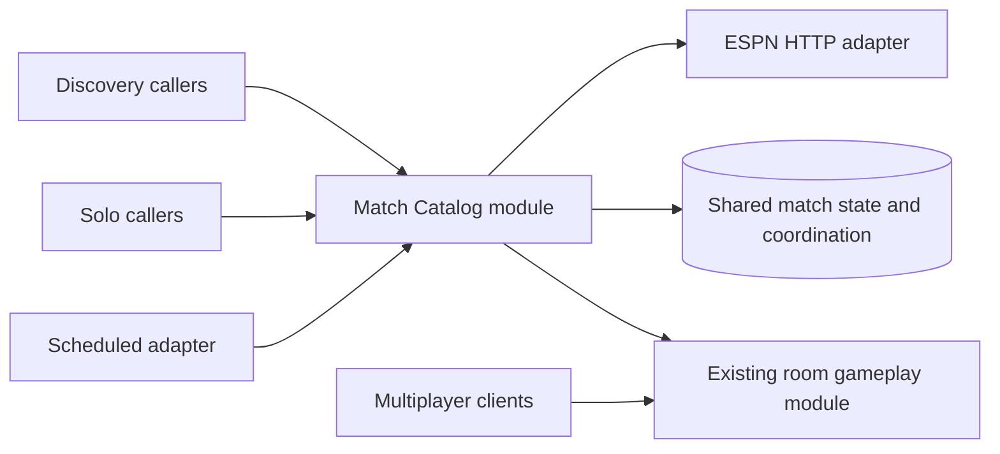

# Match Catalog architecture proposal

**Date**: 2026-10-25
**Status**: Proposed architecture for implementation planning; no application code or schema changed
**Skills applied**: codebase-design (including Deepening and Design It Twice), simplify, existing Supabase/Postgres guidance
**Constraints**: shared ESPN request reduction; closed-client monitoring from known kickoff; Supabase Free; compact rosters and expanded final team statistics; no permanent raw archive; existing room scoring/history and solo ownership preserved.

## Current implementation and the actual seam problem

There are three independent acquisition paths:

1. Java `MatchDiscoveryService` and `MatchCacheService` fetch and cache ESPN discovery data by league/date inside one process.
2. Edge `refresh-provider-scores` claims work for one session, fetches scoreboards, normalizes observations, and commits them to that room.
3. Client `useLiveScores` fetches ESPN directly, including a separate connectivity probe, and `utils/espnParsing.ts` converts provider data for solo play.

`useActiveGameRoomSync` also combines reading room state with periodic registered-client provider refresh. It refreshes on room broadcasts as well as polling. Leaving source acquisition in that path would continue to couple reads/reconnects/broadcasts to ESPN work.

The current private provider batch acceptance still requires an active registered participant and a room refresh lease. Server credentials alone do not remove that actor requirement. A scheduled worker cannot safely become an imaginary host merely to reuse that shape.

The new seam is **accepted shared match information plus declarative tracking**, not "refresh this room." Provider facts must be acquired once and room consequences must be applied durably afterward.

## Three designs considered

### 1. Edge-led MatchFeed module

Illustrative interface: `getMatches(selection)`, `syncTracking(scope)`, `runDueWork()`.

The Edge implementation owns orchestration, ESPN extraction, compact projections, and recovery, while Postgres enforces durable invariants. This concentrates existing Edge provider code and has high depth: callers need not learn fetch grouping, freshness, leases, budget accounting or parser shapes.

Its weak point is a polymorphic read interface that can acquire data for a league/date query but only read for an ID query. Those side effects are part of the interface even if hidden by one method name. Keeping explicit acquisition and read operations is easier to reason about. Scheduling rules must also have one authoritative owner rather than being independently reimplemented in Edge and SQL.

### 2. Java-led MatchFeed module

Illustrative interface: `select(selection)`, `replaceInterest(scope, matches)`, `read(matches)`, `advance(limit)`.

This preserves Java as the owner of the ESPN integration and gives strong locality around discovery and typed extraction. Postgres still owns atomic claims, budget consumption and authoritative room consequences.

The deployment instructions in `docs/production-hosting.md` specify Cloud Run minimum instances zero and request-based billing. An in-process Java timer is therefore insufficient for closed-client recording. A scheduled adapter must invoke bounded Java work, introducing Supabase-to-Java-to-Postgres hops, cold-start sensitivity, and another privileged deployment in the live-score path. Current host-JWT transport is also not the worker credential adapter. This is viable, but has more operational coupling for the stated Free-tier goal.

### 3. Database-led Match Catalog module with a small Edge runner

Illustrative consumer interface: `discoverMatches(selection)`, `readSavedMatches(catalogMatchIds)`, `replaceSoloTracking(selection)`. Multiplayer tracking is derived inside existing authoritative game lifecycle commands. A restricted scheduled adapter advances due work through the module's internal seams.

Postgres owns durable demand, due eligibility, global claims/budget, accepted versions and room progress. The Edge implementation owns HTTP and ESPN-specific normalization. Routine room readers continue using the existing room snapshot interface.

This has the strongest locality for the invariants already concentrated in Postgres and the smallest interface for common room callers. Its cost is additional explicit SQL behavior and migration work, so it must remain a small set of named transactions rather than a generic database workflow framework.

## Recommendation

Choose design 3 with the cohesive Edge implementation from design 1. Treat it as one tier-spanning **Match Catalog module**. Its private implementation is split by ownership, not replicated across callers:

| Responsibility | Single owner |
| --- | --- |
| Authoritative demand, eligibility, next due time, budget and fetch ownership | Private Postgres operations |
| ESPN URLs, request headers/timeouts, resource-specific fields and normalization | Edge ESPN adapter and pure normalization functions |
| Saving accepted match facts, meaningful versions, compact rosters/statistics | Transactional Postgres implementation |
| Scheduling wakeup and bounded processing orchestration | Small trusted Edge runner; all durable decisions/progress remain stored |
| Assignments, baselines, manual adjustments, drinks, departures, room sequencing/history | Existing room gameplay module, deepened at its trusted-observation seam |
| Presentation, client read caching, solo local consequences, foreground recovery | Existing client modules consuming normalized results |

The module's depth comes from the behavior behind this interface. It is not a pass-through wrapper around several old fetchers. If deleted, the shared acquisition, budgets, normalization and recovery complexity would reappear in multiple callers: it passes the deletion test.



## Consumer interface and invariants

The following types are illustrative, not committed code. Avoid exposing a transport, table name, provider request key, lease token, storage quota counter, or raw ESPN type to ordinary callers.

```typescript
type FootballMatchService = {
  discoverMatches(selection: MatchDiscoverySelection): Promise<MatchDiscoveryResult>;
  readSavedMatches(catalogMatchIds: SavedMatchId[], options?: { projection?: 'live' | 'history' }): Promise<SavedMatchesResult>;
  replaceSoloTracking(selection: SoloTrackingSelection): Promise<SoloTrackingGrant>;
};
```

- `discoverMatches` is explicitly a bounded demand operation. It returns suitable saved discovery data, or admits a budgeted cold acquisition. An initial cold discovery should not unnecessarily wait for the next minute tick; the admitted work can use the same runner immediately. Simultaneous demand shares the durable claim.
- `readSavedMatches` is strictly read-only: it cannot spend ESPN budget, renew interest, change schedules or trigger provider work. A reconnect, user refresh or room broadcast must not become an acquisition command.
- `replaceSoloTracking` replaces a bounded selection of existing validated catalog matches and returns a scoped tracking grant. The grant includes the opaque handle authorizing subsequent tracking changes, not merely proof that a request completed. It carries no private player names, assignments or local history. Repeating the same scoped replacement is idempotent and does not bypass kickoff, budgets or freshness.
- Multiplayer tracking is established/changed/removed inside authoritative selection/start/edit/end/expiry operations, not through a client sequence of "start, then remember to follow." No client-presence heartbeat controls whether an eligible multiplayer game is monitored.
- Results include accepted versions, last successful provider check, current availability/freshness, and useful deferred/error information. A successfully empty selection is distinct from unavailable, pending or partial data. Saved data can coexist with a refresh error.
- Invalid selections, unknown identities, access rejection, admission limits and capacity pressure have explicit outcomes. They never cause a fallback URL sweep or direct ESPN request from a caller.
- Discovery may spend provider budget; reading may not. Keep this distinction explicit rather than combining both into `getMatches` with a hidden `forceRefresh` flag.

The module also has restricted lifecycle and scheduled capabilities. These are internal seams reached by trusted adapters, not methods exposed through a general client object. The trusted worker calls one cohesive `runDueMatchWork` operation; it does not expose claim/fetch/commit ordering to client callers.

## Worker and room-processing sequence

Each scheduled pass performs bounded work and makes progress durable:

1. Resume pending room processing from already accepted observations, even if no new source fetch is due.
2. Atomically claim eligible request groups and reserve the shared budget using database time. Due work comes from active demand, known kickoff and accepted lifecycle, not a caller-supplied polling interval.
3. End the transaction, then fetch ESPN outside database locks with a bounded timeout and concurrency.
4. Normalize and validate compact observations. Do not import client hooks, stores, platform adapters or logo-caching side effects into Edge parsing.
5. Commit current facts, meaningful accepted versions and pending room progress only if the fetch ownership is still valid. Record cooldown/next-work state on failure. Ambiguous attempts after a crash are conservatively counted, not automatically refunded.
6. Apply saved versions to eligible room matches in bounded room transactions. Each transaction checks room lifecycle, applies existing scoring rules, records events/sequence and advances its processing receipt atomically.
7. Retire work for ended rooms without blocking other interested rooms; finish bounded completion enrichment for rosters/final statistics within remaining allowances.

One room failure must not roll back accepted source data or all other rooms. A crash after source commit but before room application is recovered by step 1 without another ESPN request. Reject delayed obsolete worker results. Lease duration must cover configured request deadlines and recovery margin; lease fencing does not make ambiguous external dispatches disappear, so budget accounting remains conservative.

No forever-running Edge loop, in-process scheduled timer, room-by-room cron, generic event bus or separate queue product is necessary. Persisted observation/progress records are the bounded work ledger. New notification delivery can later consume committed room events, but no notification framework is built here.

## Trusted provider observation seam in room gameplay

Refactor the shared score-consequence implementation so it has two deliberate entrances:

- Existing participant commands retain membership/role checks and participant provenance.
- A narrowly granted trusted provider entrance accepts a **saved shared observation reference**, verifies its provider identity and room match linkage, and records explicit system/provider provenance. It must not accept arbitrary client scores or a fabricated participant account.

Do not weaken existing participant authorization globally. Review event/command-result actor constraints and generated contracts when adding system provenance; do not delete historical participant attribution. Reuse one implementation for baselines, corrections, assignments, departures, drink changes, sequencing and idempotency.

Provider occurrence time remains supporting information. This refactor must not silently introduce retroactive assignment semantics or recalculate completed rooms. Source versions must be replayed in their accepted order, with room locks acquired consistently and no unbounded cross-room transaction.

## Solo and public discovery admission

Existing solo/discovery access must not require a new account just to read public match facts, but anonymous clients must not be able to manufacture unlimited monitoring:

- Admit only supported, bounded discovery selections and validated catalog identities; never arbitrary provider URLs or unvalidated match IDs.
- Bound selection sizes, admission rate, active demand, and the monitoring horizon. A client-generated tracking ID is not authority to create permanent work.
- A server-issued opaque solo handle is scoped to its accepted public-match selection and finite monitoring horizon. It does not grant room access or represent a personal account.
- Reads do not renew monitoring. Explicit solo selection/end operations change demand; ordinary closed-app multiplayer monitoring follows canonical game lifecycle.
- Budget and capacity checks remain global. A warm-process map or per-client timer may improve convenience but cannot be their authority.

Exact admission limits and handle verification must be resolved in formal planning and tested. Do not create a broad identity/security subsystem or add anonymous accounts solely to support this feature. A `SoloTrackingGrant` is distinct from an internal room observation-processing receipt: the former conveys scoped authority; the latter records completed processing.

## Proposed code placement

```text
types/footballMatch.ts
utils/footballMatchService.ts

supabase/functions/_shared/football-matches/
  footballMatchService.ts              # cohesive module orchestration
  espnHttpClient.ts           # only provider HTTP implementation
  espnMatchNormalizer.ts   # pure compact match/goal/roster/stat projection
  postgresFootballMatchRepository.ts             # narrow owned-transport adapter

supabase/functions/discover-matches/index.ts
supabase/functions/run-match-monitor/index.ts
supabase/migrations/      # new reviewed private operations and access wrappers
supabase/tests/database/  # persistence/concurrency/access verification
```

These are candidate paths, not instructions to create every file immediately. Keep small helpers beside their owning behavior until a real second caller or distinct dependency justifies extraction. Reuse existing provider normalization code where correct and remove superseded copies after caller migration.

`types/footballMatch.ts` contains provider-neutral application facts and uncertainty/freshness outcomes. It must not import the store, React, Tamagui, or runtime-specific server packages. Backend-only ESPN payload types stay with `espnHttpClient.ts`/`espnMatchNormalizer.ts`. Do not create a generic provider registry merely because another source might exist later.

## Refactor scope authorized by the user

The user explicitly permits replacing old code that does not fit the feature. Preserve behavior and data ownership, not obsolete fetch structure:

1. Move active provider HTTP/parsing ownership into the Match Catalog implementation, using the existing Edge work as a starting point.
2. Replace direct solo ESPN calls and the ESPN connectivity probe with catalog reads/tracking. Keep local solo baselines/consequences private and idempotent. Remove obsolete parsing/types only after their remaining callers are migrated.
3. Remove provider-refresh timing from `useActiveGameRoomSync`. Keep room hydration, optimistic commands, realtime invalidation, polling recovery and generation fencing.
4. Make discovery consume the same catalog acquisition path. Prefer switching maintained client discovery directly to its transport adapter; preserve the normalized discovery shape through a small migration mapping when necessary.
5. The Java `/v1/matches` route may temporarily forward to the catalog for already deployed clients. It must use the same stored eligibility/budget and never fall back directly to ESPN. Retire the independent `RestClientEspnClient`, Caffeine freshness ownership, and related unused scaffolding once callers and compatibility requirements permit. Java's unrelated room-command responsibilities remain intact.
6. The existing `refresh-provider-scores` entry can briefly map old calls to authorized reading/replay while scheduled tracking takes over; it cannot remain a second fetch owner. Validate old-client behavior explicitly, then retire the adapter when its compatibility purpose ends.

Do not keep a permanent layer just to preserve an internal class name. Temporary compatibility has an explicit purpose, observed consumer population, removal condition, and no independent business policy. Cutover must fence old fetchers before replacements activate; duplicating upstream requests as a permanent shadow comparison defeats the feature.

Preserve existing solo provider IDs and room match UUIDs at their application contracts while introducing shared provider identities internally. Explicitly map source identity and room identity; never replace room IDs with an ESPN ID throughout the client store.

## Dependency strategy and verification

| Dependency category | Implementation and test adapter |
| --- | --- |
| In-process | Pure normalization and compact-result calculations; test ordinary functions with controlled inputs. No interface for every helper. |
| Local-substitutable | Disposable real Postgres for uniqueness, claims, budget serialization, source versions, receipts and access checks. In-memory mocks cannot establish lock/transaction correctness. |
| Remote but owned | Thin Supabase/HTTP adapters and an in-memory catalog adapter for client behavior. Keep transport/access checks where they add distinct evidence. |
| True external | Injected ESPN HTTP adapter in production; controlled response adapter in tests. No live ESPN calls in routine automated verification. |

Inject dependencies at the module composition point. Use database time for authoritative claims and controlled time inputs for pure policy checks. The interface is the test surface: assert data/freshness, attempt counts, accepted versions, room consequences and recovery outcomes, rather than internal helper call order.

High-value cases:

- 100 overlapping rooms plus solo/discovery consumers produce one eligible acquisition per request group, including concurrent cold demand.
- Reading saved data, reconnecting and processing a room broadcast produce zero ESPN attempts.
- No clients are connected at kickoff; due source work and room consequences still progress.
- A crashed/obsolete worker cannot overwrite newer data, and ambiguous attempts do not evade budget accounting.
- Source commit succeeds, some room processing fails, and the next pass completes it without another fetch or duplicate drinks.
- Ended rooms, departed participants, manual adjustments and assignment changes preserve existing rules; system observation provenance cannot grant participant powers.
- One completion-detail response supplies shared compact rosters and expanded final team statistics; missing fields remain unknown and unused substitutes are not called appearances.
- Retention/capacity pressure evicts disposable records and stops optional collection without deleting referenced history or introducing a raw archive.
- Origin/auth/error/partial-discovery transport behavior remains explicit. Source configuration/header defects are tested at the ESPN/ingress adapters rather than repeated at every client.

As new interface-level coverage becomes equivalent, remove superseded per-caller polling tests instead of layering duplicate assertions indefinitely. Keep independent concurrency, authorization, transport and platform checks because they prove different failures. Any authored mobile interaction tests must follow the repository's ARTEMIS exploration requirements; this design does not claim runtime or device verification.

## Simplicity review

- One provider HTTP/parsing owner; one authority for durable due/budget/claim rules; one room scoring implementation.
- Small explicit consumer verbs. No caller-managed fetch/claim/accept sequence, force-refresh bypass, raw ESPN payload contract, generic repository per table, event-bus abstraction, provider plugin registry, or permanent archival subsystem.
- Tables are implementation details. The module interface need not grow when an internal table/index changes or another supported final statistic is retained.
- Prefer a cohesive bounded runner and a few explicit private transactions over layers of delegating classes. Keep real internal seams for ESPN, owned transport, and database execution because production and test adapters actually differ.
- Simplify authorizes behavior-preserving refinement. It does not justify deleting room access checks, retry/receipt safety, existing physical-platform behavior, or unrelated dirty work.

## Operational evidence and unresolved planning details

Supabase documents `pg_cron` plus `pg_net` for scheduled Edge invocation. Its current Free Edge runtime has 150-second wall-clock duration and a 2-second CPU limit per request; bounded batches and durable continuation are therefore preferable to a long-lived worker. Actual batch size, concurrency, query plans, storage reserve, solo admission horizon, clock policy and old-client compatibility duration require measurement/configuration during planning.

The design does not assume an always-on Java process, a reliable in-memory Edge cache across invocations, a provider-approved ESPN quota, or unlimited free storage. It selects no new paid runtime and makes no live ESPN requests during this architecture review.

References:

- [Supabase scheduled functions](https://supabase.com/docs/guides/functions/schedule-functions)
- [Supabase Edge limits](https://supabase.com/docs/guides/functions/limits)
- [Current Free-tier storage policy](free-tier-storage.md)
- [Specification](spec.md)
- [Existing hosting instructions](../../docs/production-hosting.md)

Formal planning must confirm deployment/contract details and identify the exact migrations and tests. This document is a design proposal, not an implemented refactor or a substitute for those checks.

The [Supabase platform review](supabase-review.md) verifies the hosted scheduling capabilities and adds concrete worker authentication, due-only dispatch, resource accounting, and Cron-history retention constraints. Apply these alongside the module design during planning.

The [naming review](naming-review.md) defines identity, roster, observation, and tracking terminology. Its proposed names clarify this design; they do not rename existing deployed contracts or revive the superseded archive schema.

Agreed analysis clarifications are authoritative in the specification/contracts: consolidation applies to supported migrated clients, failure pauses distinguish group/provider scope, solo details persist in local snapshots rather than anonymous server pins, grant derivation includes a fresh server issuance identity, and pending room mutations use a committed typed outcome. The optional saved-only `history` projection changes payload selection, never acquisition or tracking behavior.
