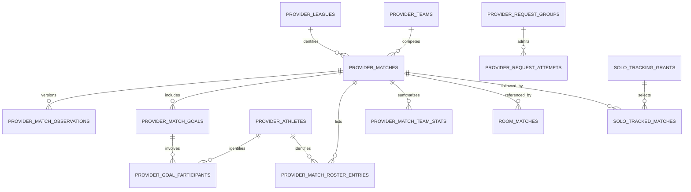

# Data model: compact shared match facts and durable processing

**Status**: Phase 1 design, 2026-10-25. No schema applied. Names describe the intended migration; existing room contracts remain intact.

## Ownership and key conventions

Provider facts and coordination live in an unexposed schema, initially `private`. Public access is through bounded sanitized operations, not table grants over internal state. Use bigint generated keys for provider-only relations; serialize catalog IDs as strings. Existing `public.matches.id`, sessions, participants, room sequences and history retain their UUID/contracts.

Absolute times are `timestamptz`. External identifiers are bounded text; never coerce them to integers or assume event ID equals competition ID. Nullable source values mean unknown. Compact enums use constrained text and preserve a bounded raw provider status alongside the normalized lifecycle. All new foreign keys have intentional deletion rules and indexes supporting their actual joins.

The diagram shows principal relationships, not a second schema or every foreign key. Multiplayer demand is derived from canonical room selection/lifecycle; it has no duplicate room-interest identity.

## Compact identity and match relations

| Relation | Principal fields and constraints |
| --- | --- |
| `provider_leagues` | `id`, `provider`, `league_code`, supplied `source_league_id`, curated `display_name`, `category`, `is_enabled`, nullable configured `default_order`, `is_default_selected`. Unique `(provider, league_code)`; release snapshots come from `constants/leagueCatalog.json`, checked in CI. The table preserves identities and admission guards without a frontend metadata fetch. Disabled rows remain for existing match tracking and saved labels. This league identity is distinct from ESPN's per-event competition identifier. No separate season/venue table initially. |
| `provider_teams` | `id`, `provider`, `source_team_id`, current display/short name. Unique validated provider team namespace. No downloaded images, current squad, standings or profile. Match side membership belongs on the match. |
| `provider_athletes` | `id`, `provider`, `source_athlete_id`, compact display name. Unique validated provider athlete namespace. No current-club history, biographies or career data. Names alone never merge identities. |
| `provider_matches` | `id`, `league_id`, `source_event_id`, separate nullable `source_competition_id`, supplied season ID/year/type, home/away team references/names, `kickoff_at`, `kickoff_validity`, raw/normalized status, nullable source completion flag, period, clock numeric/display values, regular/understood extra-time/shootout/aggregate score contexts, optional venue ID/name, `observation_version`, accepted projection attempt sequences, last attempt/success times, availability/error, state-condition start, next match eligibility, completion-detail attempt count/deadline, current scoreboard request-group reference, cache/use times. |

For the supported soccer projection, unique `(league_id, source_event_id)` identifies an event only after validating that its competition selection is unambiguous. Store the actual competition ID independently. Multiple ambiguous competition entries, conflicting known competition IDs, or inconsistent teams produce an explicit identity conflict, not an automatic merge. A legacy stub with unknown competition can be resolved by a validated matching response; never copy the event ID into the competition field merely to fill a null.

Both team identities must belong to the accepted match response; unknown source IDs may preserve supplied side names without inventing global team identities. Non-null home/away team keys must differ. Scores/counts are nonnegative integers with application bounds; invalid/absent values do not overwrite a previous valid score. Store raw score contexts separately from the gameplay score pair; shootout/aggregate numbers must not silently become normal goals.

Kickoff validity is `confirmed | tentative | unknown`; absent time remains null. Normalized lifecycle is `scheduled | live | delayed | suspended | postponed | finished | canceled | abandoned | unknown`. Normalize only verified provider meanings; preserve uncertainty. Availability is a separate dimension (`available | partial | pending | unavailable | deferred`), not a lifecycle value.

Only current clock/statistic/display facts are replaced in place. Last successful check can advance without a new meaningful observation. A room sync timestamp cannot advance it.

## Accepted evidence and selected detail

| Relation | Principal fields and constraints |
| --- | --- |
| `provider_match_observations` | `id`, `match_id`, strictly increasing `observation_version`, absolute accepted gameplay score pair, accepted lifecycle/kickoff snapshot and validity, bounded meaningful-change kind/set, `observed_at`, nullable `provider_occurred_at`, copied source resource identity/attempt sequence, compact correction/goal-change evidence. Unique `(match_id, observation_version)` and per-match accepted attempt/projection replay identity. Immutable after acceptance. |
| `provider_match_goals` | `id`, `match_id`, nullable supplied source goal ID/namespace, type, credited team, period/clock/display clock, nullable provider occurrence time, observed time, nullable penalty/own-goal/shootout facts, current correction/retraction status, first/latest observation references. Unique source identity only when supplied and verified. Required substantive corrections are retained as compact evidence in observations, not a generic event-version archive. |
| `provider_goal_participants` | Goal reference, athlete reference when known, unresolved display name when no source athlete ID, nullable explicit role and original source order. Stable local row identity; source order is not proof of scorer/assist. Keep only supplied compact participants, not athlete profiles. |
| `provider_match_roster_entries` | Local row key, match/team/athlete references, unresolved display name when identity absent, shirt number as text, compact position code/name, nullable `is_starter`, nullable `has_appeared`, supplied minutes, compact substitution-in/out period/clock/display fields. At most one accepted entry per known `(match_id, athlete_id)`; supplied unresolved entries retain local identity without being merged by name. One current/final squad, not one roster per poll. |
| `provider_match_team_stats` | Primary key `(match_id, side)` with `side = home | away`, nullable team FK validated against that side; source observation/projection sequence, finality, nullable typed selected scalar columns, optional bounded known numeric extras. Missing team ID cannot prevent retaining valid supplied metrics. No timestamp-series or EAV metric table. |

Observation comparison is against the latest meaningful accepted state, not a globally unique hash. `1–0 → 0–0 → 1–0` is three versions. Unchanged responses and clock-only updates append none. A substantive supplied goal correction can append compact evidence even if the score pair is unchanged; room processing then advances its cursor without inventing a score consequence.

Goal IDs may be absent. An internal goal row key does not establish an authoritative source identity. Reuse an id-less entry only where supplied context gives a verified unambiguous match; otherwise retain bounded unresolved evidence/partial availability rather than falsely merging, inventing roles, or creating duplicates on every poll. Absence from a partial response is not retraction evidence.

Roster `false` means explicitly established false; unknown remains null. Do not assume every listed substitute played. Supplied minutes are not extrapolated from ambiguous match clocks. Known athlete identities are shared, while historical match team/position/shirt/participation belongs to the roster entry.

Typed team metrics initially cover possession; total/on-target/blocked shots; penalties attempted/scored; fouls, corners, offsides, saves, yellow/red cards; passes, crosses and long balls attempted/completed; tackles attempted/successful; interceptions; clearances; supported source percentages. Counts are nonnegative; percentages are numeric in `[0,100]`. Retain the source-reported percentage where selected rather than overwriting with a differently rounded calculation. A missing final metric does not erase a valid existing value or become zero. Sparse extras admit only named understood metrics, units and scalar values; no arbitrary nested response map.

## Request coordination and operation accounting

| Relation | Principal fields and constraints |
| --- | --- |
| `provider_request_groups` | `id`, provider/resource kind, canonical server-derived scope key, validated league/date/options for a scoreboard or exact catalog/source event/competition for a summary; last attempted/success times; `next_attempt_at`; finite discovery demand expiry; failure count/classification and cooldown; lease token/generation/expiry; current attempt sequence; successful empty-result marker. Unique `(provider, canonical_scope_key)`. Never accept client URLs/scope keys. |
| `provider_request_attempts` | Increasing sequence/key, group reference, purpose (`live | discovery | completion`), reservation/start/end times, owner generation, outcome/status/error classification, optional safe byte/timing counts. Includes uncertain reservations. No bodies or headers. Indexed for rolling-window counting/reporting; age/byte capped after essential state expires. |
| `provider_budget_state` | One provider control/config row: ownership mode/generation, rolling-window duration/limit, UTC-day key/count/limit, provider-wide cooldown/pause, capacities, policy values, diagnostic/capacity state. Worker admission locks this row before group ownership. Missing/invalid configuration fails closed. |
| `provider_worker_slots` | Initially two fixed slot rows: dispatch token/generation, expiry, pg_net request reference, start/last-progress/outcome. Provides durable dispatch suppression/recovery without treating pg_net's unlogged queue as the work ledger. |
| `provider_request_daily_usage` | Bounded day/provider/purpose/outcome totals retained 90 days, plus per-group detail retained at most 30 days. Upsert counters; copy safe finite scope labels instead of FKs pinning provider groups/matches. Scope labels are bounded; never arbitrary caller-controlled strings. |

Short-lived attempts must not be permanent foreign-key parents of retained observations. Copy the compact accepted attempt sequence/resource provenance into observations, while retaining any separately required stable identity. Daily counters plus recent reservations support budget accuracy even after diagnostic eviction. Never delete current rolling-window reservations, outstanding fenced work, or necessary provider cooldowns to meet a diagnostic byte cap.

A scoreboard can serve many matches; each match can move between scoreboard dates when a verified schedule/request-date mapping changes. A summary is a separate resource group for one match. Both share the same provider budget. Attempt sequences fence score and optional-detail projections across resource groups; per-group leases alone cannot prevent an older board overwriting a newer summary. Missing optional fields are merged deliberately, not used as blanket replacements.

## Solo demand and admission

| Relation | Principal fields and constraints |
| --- | --- |
| `solo_tracking_grants` | Server-generated UUID primary key serving as immutable issuance identity, unique grant digest, creation-nonce digest, signing key ID, immutable creation operation/request digest, creation/expiry, ended state, accepted selection version and latest replacement replay state. No plaintext token/nonce, room, account, private player names or local history. Initial cap 200 active grants. |
| `solo_tracked_matches` | Composite `(grant_id, match_id)`, admitted horizon. Maximum 20 selected matches/grant; FK to validated catalog match. Removing/ending/expiring a grant removes active demand, not retained room history. |
| `provider_admission_counters` | Short-lived bounded global/grant/window counters; optional HMAC caller identifier only after trusted transport identity verification. No raw IP, bearer credentials or persistent user-tracking identity. |

Grant creation/replacement and capacity/group admission occur atomically. A supplied grant authorizes only its selection, with expiry and idempotency checked before mutation. Reusing an operation UUID with different content conflicts. Derive the token using domain-separated WebCrypto HMAC-SHA256 over server issuance UUID plus client 256-bit nonce and a versioned server-only key. Concurrent duplicate creation resolves to one stored issuance/digest. Unexpired matching creation retries recover that issuance; expired rows return `tracking_expired`. After purging expired metadata, new admitted creation allocates a fresh UUID/token and consumes creation allowance, including nonce reuse; old tokens remain invalid. Signing material is retained only for unexpired issuance recovery and fails closed if missing. Replacement compares expected selection version/latest operation digest; stale earlier retries cannot undo newer selection. Store neither plaintext token nor nonce, and introduce no permanent tombstone/history pin.

Keep the immutable creation digest separate from replacement replay fields. A creation retry after a later replacement returns the same capability with the current selection/version; it never restores the original selection. Future-overlap admission is recomputed under the provider admission lock from canonical room selections and grant links using the four-hour forecast windows in research; no second independent interest ledger is introduced.

## Existing room relations: additive changes

Add to `public.matches`:

- Nullable `catalog_match_id` with a restrictive provider-match FK; current room UUID/source fields remain.
- Nullable `tracking_started_observation_version` and `last_applied_observation_version`, plus last successful room provider-application time. Composite foreign keys reference `(catalog_match_id, observation_version)` in accepted observations, with restrictive deletion. Use null before any accepted anchor rather than a nonexistent version-zero FK. Progress is monotonic within each active tracking interval and cannot exceed accepted source version.
- Minimal bounded replay retry metadata only where needed; pending replay is identified by linked room cursor behind shared observation version, not a permanent row for every room/version.

Canonical active demand and routine replay both require in-progress session state and currently selected common/assigned matches, not every historical pool row left in a room. Inactive pool cursors cannot keep dispatching work when another room updates the shared match. Authoritative add/start/edit/reassignment/leave/end/expiry operations recompute affected due eligibility in the same transaction; no client subscription step. Reassignment that removes a match removes its monitoring demand unless another eligible room/grant needs it. Reactivation reconciles the latest saved score once as a new tracking-interval anchor, skipping the inactive interval's individual versions. Completed/historical references remain protected even though they do not generate live demand.

Preserve joinable-only room expiry. An in-progress room is not automatically expired because no app is connected or kickoff is old. Slow uncertain-match monitoring may continue under the global budget until authoritative lifecycle/selection or verified match terminal state removes demand.

### Provenance and authorization

`gameplay_events` gains `actor_kind` defaulting existing rows to `participant` and an accepted observation reference for provider-origin events. Relax participant actor nullability only with an exclusive constraint:

- Participant-origin event: participant actor required, same-room composite FK retained, no provider observation used as substitute authority.
- Provider-origin event: participant actor null, saved observation and typed `room_match_id` required, source match linkage validated against that room match and observation; allowed event kinds constrained to provider score consequences. Use typed FKs plus a private invariant check/constraint trigger for cross-table match ownership rather than trusting a JSON payload field.

Do not alter participant authorization, immutable completion/event guards, or participant-only `gameplay_command_results`. Trusted processing uses the room cursor and a deterministic room-match/observation/event-kind idempotency key; no fake participant command. Keep one shared score-consequence implementation behind two checked entrances.

Audit every event/snapshot/history projection and generated client contract for the new nullable participant actor. Provider-origin records must not disappear through an inner participant join, be labeled as a deleted participant, or acquire participant-only controls. Use explicit actor-kind presentation while preserving existing participant-origin history.

### Adoption and transition ordering

1. Lock the room and relevant room-match rows in stable order; verify canonical lifecycle/linkage.
2. Resolve exactly one valid catalog identity. Record latest saved observation as reconciliation anchor; do not replay all earlier catalog history.
3. Linking alone does not initialize scores or consume a version. New room matches remain at existing 0–0 defaults; there is no separate persisted multiplayer baseline. For an eligible in-progress room, apply saved absolute pair N against its current pair using the existing score-consequence implementation, then set anchor/cursor to N atomically. First 2–1 on a new match yields one 0–0 → 2–1 snapshot-change event; existing 2–1 adopted against 3–1 yields one event; identical pairs emit none. Never invent individual goals or introduce a subtractive baseline. Completed rooms gain references only, never reconciliation.
4. If no accepted source observation exists, preserve current room score and null anchor/cursor until the first valid check. Metadata stubs are not accepted score observations.
5. Apply subsequent versions in order. Already consumed versions do nothing; updates/events/sequence/cursor commit together.

Before assignment, participant departure, or completion snapshots change authoritative context, capture a source-version cutoff and drain accepted pending observations through that cutoff under the room lock. Work is bounded; return retryable `room_processing_pending` with no requested mutation if the backlog cannot be drained. The background runner resumes saved replay. Source commits concurrent with the captured cutoff are processed according to the serialized room transition; occurrence timestamps do not create retroactive assignment semantics.

Return pending as a normal committed JSON result, not a raised SQL exception: processing progress persists, requested mutation stays unapplied, and no terminal successful command result is stored. All transports use the exact HTTP-200 pending body in the worker contract. Retry bounds, original idempotency key/payload and stale-precondition conflict behavior are shared requirements.

Source acceptance never holds a room lock and cannot be rolled back by another room's application failure. A room transaction either records all its effects and progress or none. No global cross-room transaction.

## State transitions

| State / event | Durable next behavior |
| --- | --- |
| New valid discovery | Saved compact facts/empty marker; finite discovery demand; no permanent monitoring unless tracked. |
| Future tracked fixture | Dormant until known kickoff; opportunistic schedule updates may move eligibility. |
| Explicit live / known kickoff reached | Eligible request group, subject to cooldown/claim/budget/capacity; normal 60-second interval. |
| Delayed/suspended/uncertain past kickoff | Persist condition start and slower schedule; never infer completion from age. |
| Verified terminal state | Stop routine match demand; bounded completion detail may remain. |
| Valid meaningful result | Atomically update compact projection/version; pending room replay is discoverable. |
| Failure / exhausted budget | Preserve saved facts, persist next eligibility/error/deferral; no fake successful check. |
| Worker crash / expired lease | Replace dispatch/claim after expiry, conservatively retain counted attempt; reject obsolete result. |
| Room/grant selection ends | Remove only that demand; retain protected facts/history; another consumer may keep monitoring active. |
| Capacity pressure | Cleanup disposable rows, defer optional enrichment, reject unsafe new persistent admission; preserve active/replay/history dependencies. |

## Query-oriented indexes

Start with primary/unique identity indexes; match discovery `(league_id, kickoff_at, id)`; accepted observations `(match_id, observation_version)`; room reverse FK index on `catalog_match_id`; goal timeline `(match_id, period, clock)`; roster `(match_id, athlete_id)` and `(athlete_id, match_id)` for who-played queries; team-stat `(match_id, side)` key; grant digest/expiry and selection links; request-group due index on `(next_attempt_at, id)` with a static enabled predicate; attempts `(reserved_at)` and `(group_id, reserved_at)`; bounded daily-usage keys.

Do not use `now()` in a partial-index predicate, duplicate PK indexes, blanket JSONB GIN, partitioning, or indexes for every statistic without query-plan evidence. Due/replay queries must use canonical lifecycle and selected-match indexes; check joins and locks against the 100-room workload.

## Retention, deletion and capacity

Use restrictive references protecting active games, pending replay and retained room history. Optional final team statistics may be shed/deferred under the explicit policy; referenced rosters and gameplay evidence may not. Deleting an expired cache match may cascade only into that unreferenced provider match's dependent projections/evidence after protection checks. Shared identities are removed only when unreferenced. Account/game deletion continues existing application semantics.

The protected server-history scope is multiplayer room history. Solo snapshots remain private local records and retain downloaded compact details under existing local history/deletion rules. The saved-only `history` projection can copy held roster/final-stat data at completion or a normal later access without altering completed outcomes. Expired shared caches cannot erase local snapshots, but uncaptured shared detail may be unavailable. A solo grant is finite demand, never a permanent anonymous retention reference. No local history, private participants or bearer grants are uploaded/exported as part of these snapshots.

Use [research policy values](research.md) and [free-tier storage policy](free-tier-storage.md): 24-hour unused discovery, 30-day unreferenced completed cache, 24-hour/5-MB attempt diagnostics, 30-day bounded per-group/90-day provider aggregate totals, seven-day feature-job history, optional raw diagnostics off or separately capped. Retire unneeded request groups after demand/allowance/protected dependencies/claims/budget evidence end; copied aggregate labels cannot pin them indefinitely. Essential claims/cooldowns/budget evidence are not disposable diagnostics. Source identity/observation links required for accepted history survive operational cleanup.

Measure `pg_total_relation_size` for every owned table/index and attributable scheduler overhead, whole-database size, protected growth and current reservations. At the initial 100-MB provider target, reclaim disposable data before stopping optional collection at 80% or rejecting new persistent tracking at 90%. Preserve at least 50 MB of whole-database application headroom and explicit active-recording runway. Benchmarks determine safe admission estimates per shared match and additional room consequence load; room count alone is not a source-cost measure. Exceeding a forecast must surface operator action while runway remains; indefinite protected growth cannot be guaranteed within finite storage.

## Migration obligations

Create new migration filenames through the CLI, not invented timestamps. Add schema/grants/indexes/nullable linkage/provenance first. Validate existing rows before tightening constraints; existing participant rows remain participant-origin. Link only unambiguous valid provider metadata without a network backfill. Update generated database types and hard-coded pgTAP schema assertions when adding columns. Verify historical snapshots remain readable and obsolete workers cannot accept after cutover. Safe rollback pauses acquisition and preserves accepted facts/progress; dropping these relations is not a rollback strategy.
