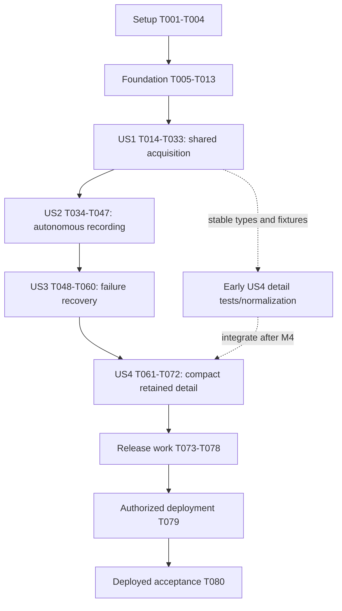

# Tasks: Reduce ESPN Requests with Shared Match Data

**Branch**: `190-reduce-espn-requests`  
**Feature directory**: `specs/030-reduce-espn-requests/`  
**Generated**: 2026-10-25  
**Input**: [spec.md](spec.md), [plan.md](plan.md), [research.md](research.md), [data-model.md](data-model.md), [consumer contracts](contracts/match-catalog.md), [worker/room contracts](contracts/worker-and-room-processing.md), [quickstart.md](quickstart.md).

**Organization**: Setup, shared prerequisites, four user stories in priority order, then cross-cutting release work. All 80 tasks start open; generation does not establish implementation, runtime acceptance, deployment permission or completion of the focused requirements review.

**User exception**: Do not create or run E2E tests. See [user-exceptions.md](validation/user-exceptions.md). T037/T075 are waived, and any other journey/E2E wording below is excluded; backend/unit/database verification remains required.

**Tests**: Constitution V requires new-behavior unit tests, pgTAP for persistence/access changes, real-Postgres concurrency evidence and affected primary-journey coverage. Write the specified tests before their corresponding behavior and establish meaningful failing cases; runner/configuration failures are not behavioral evidence. Follow the ARTEMIS prerequisite before authoring executable app interaction tests. No live ESPN calls in routine automated checks.

## Format and path conventions

Every task has `- [ ] T### [P?] [US#?] Description with path`. Paths are repository-relative. `[P]` means distinct output files with the stated prerequisites already satisfied; it does not authorize concurrent edits to shared migrations, fixtures, generated types or a shared test reset. Numbering orders work, while the dependency section specifies the permitted parallel windows.

New migration timestamps must come from the installed CLI. Do not create empty migrations during task generation or invent filenames. The concrete migration path is bound when its first task runs and is recorded in `validation/rollout.md`; later tasks with that stem edit the same returned file:

| Alias | Creation task and command | File pattern, resolved by CLI |
| --- | --- | --- |
| M1 | T009: `npm run db:new-migration -- match_catalog_core` | `supabase/migrations/*_match_catalog_core.sql` |
| M2 | T020: `npm run db:new-migration -- match_catalog_consumers` | `supabase/migrations/*_match_catalog_consumers.sql` |
| M3 | T038: `npm run db:new-migration -- match_catalog_monitoring` | `supabase/migrations/*_match_catalog_monitoring.sql` |
| M4 | T052: `npm run db:new-migration -- match_catalog_recovery` | `supabase/migrations/*_match_catalog_recovery.sql` |
| M5 | T064: `npm run db:new-migration -- match_catalog_retention` | `supabase/migrations/*_match_catalog_retention.sql` |

Create M1–M5 in that order. Schema/type updates happen at each checkpoint; do not postpone generated contracts or hard-coded schema assertions until final release. Existing migrations are context, never files to rewrite for this feature.

The earlier full-source archive in `storage-design.md` is superseded. No raw archive, source-document bucket, provider v3 switch, notifications, new statistics screen, anonymous account system or generic workflow framework is included. Preserve unrelated dirty work and the deployed header/CORS fixes.

---

## Phase 1: Setup

Reuse the existing project; do not initialize another app or install a new framework. Complete T001 first. T002 establishes the disposable environment; T003 must precede authored app tests. T004 can run alongside T003 after T002.

- [X] T001 Review all 40 requirements-quality questions in `specs/030-reduce-espn-requests/checklists/provider-data.md`, record evidence/findings, resolve material conflicts in the linked design documents, and check items only when the writing satisfies them; preserve unrelated work.

- [X] T002 Prepare an isolated disposable Supabase profile and ignored fixture-only environment at `supabase/functions/.env.match-catalog.local`; update `.gitignore` and `specs/030-reduce-espn-requests/quickstart.md` with local bindings, policy setup and safeguards preventing hosted resets or real ESPN routing.

- [X] T003 WAIVED for Android/device testing by the user on 2026-10-26; browser baseline inspection and pure unit checks are recorded in `validation/artemis-exploration.md`. No Android or app journey acceptance is claimed.

- [X] T004 [P] Record current Jest, pgTAP, type/Edge checks, lint, unused-code and affected Java baselines in `specs/030-reduce-espn-requests/validation/baseline.md`, distinguishing environment failures and existing regressions from feature results without modifying production data.

---

## Phase 2: Foundational — shared acquisition prerequisites

Blocks all stories. Types and fixtures precede tests; T007–T008 may run together after T005–T006 and the exploration prerequisite. T009–T012 are ordered implementation work. Acquisition remains disabled outside explicitly configured disposable tests.

- [X] T005 Define provider-neutral `FootballMatchService` operations, opaque string catalog IDs, external identity namespaces, saved goal/current-stat fields, nullable uncertainty, versions, availability and safe errors in `types/footballMatch.ts` according to `contracts/match-catalog.md`.

- [X] T006 Create deterministic provider fixtures in `__tests__/fixtures/matchCatalog/` and disposable seed data in `supabase/tests/fixtures/match_catalog.sql`, covering distinct event/competition IDs, future/live/final/empty/partial data and existing seven-stat/goal displays; reuse recorded samples instead of fetching ESPN.

- [X] T007 [P] Add failing unit coverage for identity/score/status normalization, unknown fields, current goal/stat extraction, explicit headers, total timeout/body limits and no inline retries in `__tests__/supabase/matchCatalogProvider.test.ts`, using an injected provider adapter.

- [X] T008 [P] Add failing pgTAP coverage for compact identity uniqueness, immutable meaningful versions, safe grants, budget configuration/initial reservations and nullable unknowns in `supabase/tests/database/320_match_catalog_core.test.sql`.

- [X] T009 Generate M1 with the CLI and implement compact league/team/athlete/match/observation and request-group/attempt/budget/worker-slot/usage state in `supabase/migrations/*_match_catalog_core.sql`, with query-oriented indexes, explicit grants and acquisition disabled by default; no full source documents or archive relations.

- [X] T010 Implement database-time request ownership, rolling/daily reservation, generation/token checks and compact source acceptance in `supabase/migrations/*_match_catalog_core.sql`; release locks before HTTP, preserve uncertain attempt counts, compare current meaningful state and reject older cross-resource projection sequences.

- [X] T011 Implement the sole ESPN HTTP adapter and pure projection in `supabase/functions/_shared/football-matches/espnHttpClient.ts` and `supabase/functions/_shared/football-matches/espnMatchNormalizer.ts`; use verified Site v2, existing Accept/User-Agent, a 10-second whole-response deadline, streaming 2-MB caps and no fallback sweep.

- [X] T012 Implement the narrow owned-Postgres adapter and module composition in `supabase/functions/_shared/football-matches/postgresFootballMatchRepository.ts` and `supabase/functions/_shared/football-matches/footballMatchService.ts`, injecting production/fixture dependencies rather than importing client stores, UI, logo caches or a generic provider registry.

- [X] T013 Regenerate `types/database.types.ts`, update `supabase/tests/database/010_schema.test.sql` for M1, and pass the core SQL/unit/type checks; record actual results in `specs/030-reduce-espn-requests/validation/foundation.md` before any story checkpoint.

---

## Phase 3: User Story 1 — Reuse match information across games (P1, MVP)

**Goal**: discovery, solo and selected multiplayer references share individual facts and one budgeted acquisition owner.

**Independent test**: with controlled provider responses and real Postgres, 100 rooms share five groups with at most five routine attempts/window; 100 additional fresh overlapping consumers add none. Saved reads/reconnects/manual-only selections add zero attempts, and applicable room scores/current solo controls remain correct. Invoke the bounded module explicitly for this checkpoint; unattended scheduling is US2, and no production activation is implied.

### Tests first

T014–T019 are independent files after foundation and can run together. Establish meaningful failing behavior before implementing the corresponding operations.

- [X] T014 [P] [US1] Add consumer-contract tests for public discovery, empty/partial/deferred outcomes, saved-only live/history projections and their ID/256-KB limits, cancellation, explicit missing/evicted-data outcomes and zero read-side acquisition (local snapshot survival is verified with its store/controller owner in T017/T029) in `__tests__/utils/footballMatchService.test.ts`.

- [X] T015 [P] [US1] Add pgTAP consumer/access tests for sanitized live/history reads, issuance-bound grant replay/replacement/version conflicts, expired-state denial, typed room linkage, provider provenance and initial score reconciliation in `supabase/tests/database/321_match_catalog_consumers.test.sql`.

- [X] T016 [P] [US1] Build a disposable real-Postgres concurrency/counting harness in `scripts/test-match-catalog-concurrency.mjs` using `supabase/tests/fixtures/match_catalog.sql`; race cold/warm discovery, solo and 100 room references and fail if provider HTTP escapes the controlled adapter.

- [X] T017 [P] [US1] Replace direct-provider assumptions with catalog behavior tests in `__tests__/hooks/useMatchData.test.tsx`, `__tests__/hooks/useLiveScores.test.tsx`, `__tests__/hooks/useGameProgressController.test.ts` and `__tests__/hooks/useActiveGameRoomSync.test.ts`; preserve local consequences/IDs/generation guards and captured local history through server-cache eviction.

- [X] T018 [P] [US1] Add null/partial-data regression coverage for existing goalscorer and seven-stat controls in `__tests__/components/gameProgress/MatchCatalogDetails.platform.test.tsx`, using the interactions recorded by T003 and no invented selectors.

- [X] T019 [P] [US1] Update catalog-forwarding contract coverage in `command-api/src/test/java/com/dong/commandapi/match/MatchDiscoveryControllerTest.java` and `command-api/src/test/java/com/dong/commandapi/match/MatchDiscoveryServiceTest.java` for current date/status/source-ID behavior, partial arrays and unavailable errors without ESPN fallback.

- [X] T020 [US1] Generate M2 and add compact goal/participant/current-team-stat relations, server-UUID solo issuances with hashed credentials/creation digests, finite selected links/admission counters, room catalog/version linkage and constrained provider event provenance in `supabase/migrations/*_match_catalog_consumers.sql`; preserve room UUIDs and participant-only command results.

- [X] T021 [US1] Implement sanitized `read_saved_matches` live/history projections in `supabase/migrations/*_match_catalog_consumers.sql`: bounded saved goals/metrics, current history availability and missing IDs, honest freshness, zero acquisition/renewal and complete private/invoker grants; M5 later supplies roster/expanded-final fields through the same history projection.

- [X] T022 [US1] Refactor one checked room score-consequence implementation and add trusted saved-observation application in `supabase/migrations/*_match_catalog_consumers.sql`; require typed match/observation linkage, atomic cursor/events and existing 0–0-to-first-score semantics, never a fabricated participant or new subtractive baseline.

- [X] T023 [US1] Implement finite solo issuance/admission/replacement/end in `supabase/migrations/*_match_catalog_consumers.sql` and `supabase/functions/_shared/football-matches/footballMatchService.ts`; bind HMAC tokens to immutable server UUID plus nonce, reconstruct only unexpired issuances, reject expired records, and treat post-purge creation as fresh counted admission with a new UUID/token that never revives old authority.

- [X] T024 [US1] Complete shared discovery/solo orchestration in `supabase/functions/_shared/football-matches/footballMatchService.ts` and `supabase/functions/_shared/football-matches/postgresFootballMatchRepository.ts`: 16-league/date bounds, valid-empty caching, five-minute discovery freshness, finite cold demand, common claims/budgets/worker slots and bounded replay of accepted room facts through T022 for synchronous acquisition.

- [X] T025 [US1] Add thin public `supabase/functions/discover-matches/index.ts` and `supabase/functions/solo-match-tracking/index.ts` adapters with bounded payloads, correct CORS on success/errors, safe error mapping and no worker authority; register their auth and Edge typecheck entries in `supabase/config.toml` and `package.json`.

- [X] T026 [US1] Implement `createFootballMatchService`/`getFootballMatchService` in `utils/footballMatchService.ts`, mapping three operations and optional live/history saved projection to owned transports, bounding follow-ups/batch splitting, decoding grant isReplay/expiry and keeping signing/backend secrets out of clients.

- [X] T027 [US1] Migrate maintained discovery in `hooks/useMatchData.ts` and `utils/commandApiClient.ts`, carrying additive catalog linkage through `store/store.ts` while preserving source event IDs, selected-date semantics, kickoff instants, league grouping and current setup/lobby callers.

- [X] T028 [US1] Preserve existing solo details with null-aware `types/matchScores.ts` and the current controls in `components/gameProgress/MatchQuickActionsModal/index.tsx`, `components/gameProgress/MatchQuickActionsModal/StatisticsSection.tsx` and `components/gameProgress/MatchQuickActionsModal/GoalScorersSection.tsx`; do not turn unknown values into zero or redesign the cards.

- [X] T029 [US1] Replace ESPN probing/polling in `hooks/useLiveScores.ts` with finite tracking and saved reads. Preserve existing local consequences and offline ownership in `hooks/useGameProgressController.ts` and `store/store.ts`; capture already available compact history detail at completion or ordinary later access without source requests, new polling, history upload or changes to completed gameplay outcomes.

- [X] T030 [P] [US1] Replace Java source acquisition in `command-api/src/main/java/com/dong/commandapi/match/MatchDiscoveryService.java` with a thin `command-api/src/main/java/com/dong/commandapi/match/MatchCatalogClient.java` compatibility adapter, preserving offset-date/array/status behavior and using public discovery authority without Caffeine freshness or ESPN fallback.

- [X] T031 [US1] Convert `supabase/functions/refresh-provider-scores/index.ts` to registered-member-authorized saved replay/no-op compatibility and remove source-refresh timing from `hooks/useActiveGameRoomSync.ts`; retain hydration, realtime invalidation, guest checks, recovery and generation fencing.

- [X] T032 [US1] Update `types/room.ts`, `utils/roomSnapshot.ts` and affected history projections in `supabase/migrations/*_match_catalog_consumers.sql` for provider actor kind/null participant attribution so provider events remain visible without participant-only controls; preserve existing participant history.

- [X] T033 [US1] Regenerate `types/database.types.ts`, update `supabase/tests/database/010_schema.test.sql`, run T014–T019 plus the controlled overlap harness, and record SC-001/SC-002 and gameplay compatibility results in `specs/030-reduce-espn-requests/validation/us1.md`.

---

## Phase 4: User Story 2 — Follow active games from kickoff with every app closed (P1)

**Goal**: canonical game lifecycle creates durable demand; one due-only scheduler advances source facts and room consequences without participant credentials or presence.

**Independent test**: close all clients before kickoff; observe no early score polling, healthy first/update recording within 90 seconds, correct consequences after crashes, and no duplicate effects on re-entry. Ending one room cannot stop another; completed/deselected matches stop normal demand. Requires the US1 shared consumer/application seam, but can be validated without optional enrichment or live ESPN.

### Tests first

T034–T037 can run together after US1 and T003. M3 edits remain sequential.

- [X] T034 [P] [US2] Add pgTAP unit cases for kickoff/unknown kickoff, request-date movement, 60-second cadence, long delay/suspension, terminal states, future overlap and idle ticks in `supabase/tests/database/322_match_catalog_scheduling.test.sql`, using controlled database-time seams rather than duplicate client scheduling policy.

- [X] T035 [P] [US2] Add lifecycle/order pgTAP cases in `supabase/tests/database/323_match_catalog_room_ordering.test.sql` and pending-forwarding cases in `command-api/src/test/java/com/dong/commandapi/command/CommandControllerTest.java`; cover selected demand, cutoffs/reactivation, preserved expiry and the exact committed pending result, original-key retries, stale conflicts and absence of a terminal success record.

- [X] T036 [P] [US2] Add worker ingress/orchestration tests in `__tests__/supabase/matchMonitor.test.ts` for secret/dispatch denial, two slots, one four-group wave, bounded replay, slot lookahead, late ownership and durable continuation without participant impersonation.

- [X] T037 [US2] WAIVED by the user: no new E2E test or E2E execution. See `validation/user-exceptions.md`; no journey pass is claimed.

- [X] T038 [US2] Generate M3 in `supabase/migrations/*_match_catalog_monitoring.sql` to enable required pg_net capability, add bounded scheduling/dispatch operations and define the single owned `match-catalog-monitor` job disabled for deployment; use Vault references rather than credential literals.

- [X] T039 [US2] Implement authoritative known-kickoff/lifecycle eligibility and next-attempt policy in `supabase/migrations/*_match_catalog_monitoring.sql`, including 60-second live start-time cadence, progressive 5/15/60/360-minute uncertain checks, actual request-date scope and no age-based completion or league sweep.

- [X] T040 [US2] Deepen add/start/edit/reassignment/leave/end/expiry through helpers in `supabase/migrations/*_match_catalog_monitoring.sql`, updating demand and draining accepted cutoffs atomically; insufficient drain returns the HTTP-200-compatible pending JSON with committed processing progress, no requested mutation, no raised SQL rollback and no terminal success entry.

- [X] T041 [US2] Implement 15-second due-only dispatch, two 60-second slot leases, 45-second pg_net timeout, current/future eight-group admission and 45-second live-slot reservation in `supabase/migrations/*_match_catalog_monitoring.sql`; recover dispatch loss from durable state, not pg_net queue survival.

- [X] T042 [US2] Implement `runDueMatchWork` in `supabase/functions/_shared/football-matches/footballMatchService.ts` and `supabase/functions/_shared/football-matches/postgresFootballMatchRepository.ts`, with replay under exhausted budgets, one four-group HTTP wave, 35-second wall bound, bounded 100-room/four-concurrent/20-observation processing and deadline-aware continuation.

- [X] T043 [US2] Add named-secret/dispatch-token validation in `supabase/functions/run-match-monitor/index.ts` and configure it in `supabase/config.toml` and `package.json`; `verify_jwt=false` must never replace actual auth, and client keys/JWTs must not authorize worker operations.

- [X] T044 [US2] Implement non-destructive legacy linking/reconciliation and unresolved-identity reporting in `supabase/migrations/*_match_catalog_monitoring.sql`; link valid existing metadata, preserve completed history and current room scores until eligible reconciliation, and perform no historical provider backfill.

- [X] T045 [US2] Propagate the exact HTTP-200 `room_processing_pending` result before success parsing in `utils/supabaseClient.ts`, `types/room.ts`, `command-api/src/main/java/com/dong/commandapi/supabase/SupabaseRestClient.java`, `command-api/src/main/java/com/dong/commandapi/command/CommandController.java` and `command-api/src/main/java/com/dong/commandapi/command/idempotency/PersistentIdempotencyService.java`; registered/guest/Java callers retry at most twice after one second with the original key/business payload, preserve stale-precondition conflicts and never cache pending as terminal success.

- [X] T046 [US2] Extend `scripts/test-match-catalog-concurrency.mjs` and the shared-monitoring journey to measure closed-client kickoff, optional-work contention, 100-room fan-out and source/room/re-entry timings; record actual SC-003/SC-004 evidence and overload distinctions in `specs/030-reduce-espn-requests/validation/us2.md`.

- [X] T047 [US2] Regenerate `types/database.types.ts`, update `supabase/tests/database/010_schema.test.sql`, run scheduling/ordering/worker/BDD checks, and finalize the US2 checkpoint in `specs/030-reduce-espn-requests/validation/us2.md` without claiming hosted or Android acceptance from browser fixtures.

---

## Phase 5: User Story 3 — Bound provider traffic and recover from failures (P1)

**Goal**: all purposes obey durable global policy; failure, restart, public demand and rollback cannot erase saved content, regress accepted data or recreate independent fetchers.

**Independent test**: inject access rejection/rate limits/timeouts/invalid data and crash at each seam. Rolling/day limits and cooldown survive restart, stale workers cannot overwrite newer projections, healthy resource-local work remains isolated, and saved room replay needs no new source request. Web/Android recovery reports real source freshness. Uses US1/US2; basic no-unbounded-fetch safeguards already exist in foundation, not deferred to this phase.

### Tests first

- [X] T048 [P] [US3] Add HTTP failure/Retry-After tests in `__tests__/supabase/matchCatalogFailures.test.ts` covering isolated group 403 versus established integration failure, provider-wide throttling, transient/malformed/oversized data and zero diagnostic probes; retain successful normalization coverage without duplication.

- [X] T049 [P] [US3] Add real-persistence recovery cases in `supabase/tests/database/324_match_catalog_recovery.test.sql` and `scripts/test-match-catalog-concurrency.mjs` for rolling boundaries, day rollover, uncertain reservations, restart, expired claims, cross-resource ordering and source-commit/room-replay interruption.

- [X] T050 [P] [US3] Add stale/offline/cancellation/re-entry regressions in `__tests__/hooks/useLiveScores.test.tsx` and `__tests__/hooks/useGameProgressController.multiplayer.test.ts`, distinguishing source last-success from room sync and preserving saved content during transient errors.

- [X] T051 [P] [US3] Add authority and issuance-lifecycle cases in `supabase/tests/database/325_match_catalog_access.test.sql` and `__tests__/supabase/matchCatalogAccess.test.ts`: concurrent creation, unexpired replay, expired-row denial, cleanup followed by fresh counted issuance, old-token rejection, signing-key rotation and secret-free errors.

- [X] T052 [US3] Generate M4 in `supabase/migrations/*_match_catalog_recovery.sql` for hardened persistent failure/cooldown, safe operator recovery, bounded diagnostics and ownership-mode operations, preserving accepted source/room history and existing participant command contracts.

- [X] T053 [US3] Implement persistent backoff/Retry-After and explicit pause scope in `supabase/migrations/*_match_catalog_recovery.sql`, with safe classifications from `supabase/functions/_shared/football-matches/espnHttpClient.ts` and `supabase/functions/_shared/football-matches/footballMatchService.ts`: a group-local 401/403 pauses only that group unless its response establishes broader scope; provider-wide throttling/configuration failure may pause the integration, without diagnostic requests.

- [X] T054 [US3] Harden rolling-60-second/daily reservation and retry accounting in `supabase/migrations/*_match_catalog_recovery.sql`, including invalid configuration fail-closed, conservative unknown dispatches, budget priority and protected recent evidence; do not refund on lease expiry or allow manual-refresh bypass.

- [X] T055 [US3] Complete stale-token/generation/cross-resource fencing and per-room transactional recovery in `supabase/migrations/*_match_catalog_recovery.sql` and `supabase/functions/_shared/football-matches/postgresFootballMatchRepository.ts`; no failed room may roll back accepted global data or another room.

- [X] T056 [US3] Complete signing-key rotation, unexpired issuance recovery, expired/purged-token rejection and explicit ingress/grant checks in `supabase/functions/solo-match-tracking/index.ts`, `supabase/functions/run-match-monitor/index.ts` and `supabase/config.toml`; new post-purge admission must use fresh server identity/count allowance, while queue/login-role audits never expose headers or trust unverified caller addresses.

- [X] T057 [US3] Integrate honest freshness/availability and nonblocking stale/pending feedback in `hooks/useLiveScores.ts`, `hooks/useGameProgressController.ts` and `app/gameProgress.tsx`, preserving existing UI/offline content and the five-second healthy saved-state recovery requirement.

- [X] T058 [US3] Implement disabled/legacy/catalog/paused ownership transitions and legacy claim/acceptance fencing in `supabase/migrations/*_match_catalog_recovery.sql`, leaving saved reads/replay available in safe mode and rejecting obsolete generations before a catalog-compatible runner resumes.

- [X] T059 [US3] Add private bounded 24-hour operator reports and daily provider/purpose/outcome/reuse/deferral aggregates in `supabase/migrations/*_match_catalog_recovery.sql` and `supabase/functions/_shared/football-matches/postgresFootballMatchRepository.ts`; copy safe group labels rather than pinning cache rows or recording private content.

- [X] T060 [US3] Regenerate `types/database.types.ts`, update `supabase/tests/database/010_schema.test.sql`, run the failure/access/restart matrix and record SC-005/SC-007/SC-008 with safe-mode and healthy-isolation scope in `specs/030-reduce-espn-requests/validation/us3.md`.

---

## Phase 6: User Story 4 — Retain compact match history and rosters on Free (P2)

**Goal**: preserve selected useful details once per match while making capacity, protected references and optional enrichment explicit. Do not implement a raw archive or new statistics screens.

**Independent test**: ingest complete/partial detail, distinguish unused substitutes/unknown appearances and null metrics, share one completion response across rooms, and enforce the combined two-attempt cap. Exceed retention/capacity thresholds with representative persisted data: disposable data is bounded while referenced history/rosters and active replay survive. Detail parsing/schema work can follow US1; actual enrichment integrates with the US2/US3 runner and policy.

### Tests first

- [X] T061 [P] [US4] Add compact detail normalization/correction cases in `__tests__/supabase/matchCatalogDetails.test.ts` for missing IDs/roles, penalty/own-goal/shootout contexts, roster participation, supplied minutes and source percentages without full-response/per-poll retention.

- [X] T062 [P] [US4] Add SQL schema/query/retention/capacity cases in `supabase/tests/database/326_match_catalog_retention.test.sql` and `supabase/tests/database/327_match_catalog_queries.test.sql`, including side-keyed unknown-team stats, bounded saved-history projection, protected room references and evictable solo-only caches without permanent anonymous pins.

- [X] T063 [P] [US4] Add bounded completion orchestration tests in `__tests__/supabase/matchCatalogEnrichment.test.ts` for shared summaries, combined failed/uncertain confirmation/detail attempts, terminal unavailable resources and no score blocking or player-by-player fallback.

- [X] T064 [US4] Generate M5 in `supabase/migrations/*_match_catalog_retention.sql` for shared roster entries, expanded nullable final team metrics and targeted query indexes; use `(match_id, side)` with nullable validated team identity and no EAV/per-poll/raw-document model.

- [X] T065 [US4] Extend `supabase/functions/_shared/football-matches/espnMatchNormalizer.ts` to extract only selected goal/correction/roster/scalar-stat fields, keeping unknown roles/appearance/minutes distinct from false/zero and dropping commentary, media, profiles and speculative nested payloads.

- [X] T066 [US4] Implement goal correction evidence, roster/final-stat upserts and bounded saved-only history/operator reads in `supabase/migrations/*_match_catalog_retention.sql` and `supabase/functions/_shared/football-matches/postgresFootballMatchRepository.ts`; share detail across rooms, preserve explicit unavailable/partial flags and allow local snapshot capture without acquisition or changes to completed outcomes.

- [X] T067 [US4] Implement completion eligibility/counters in `supabase/migrations/*_match_catalog_retention.sql` and `supabase/functions/_shared/football-matches/footballMatchService.ts`: first summary at completion+five minutes, at most one retry after 15 minutes, two combined attempts within 24 hours including confirmation/failure/ambiguity, under the same global budget.

- [X] T068 [US4] Implement bounded cleanup in `supabase/migrations/*_match_catalog_retention.sql`: 24-hour unused discovery/attempts, 30-day server-unreferenced completed cache/group detail, 90-day totals, seven-day owned Cron history, safe group retirement and expired grant cleanup. Protect active evidence/room references; solo local snapshots are unaffected, and purged grants cannot resurrect an old issuance/token.

- [X] T069 [US4] Implement actual relation/index/whole-database usage and protected-growth forecasting in `supabase/migrations/*_match_catalog_retention.sql`, with the 100-MB feature target, post-cleanup 80% optional/90% new-demand thresholds and at least 50-MB whole-database headroom; keep raw diagnostics disabled by default.

- [X] T070 [US4] Integrate capacity/future-overlap/remaining-day admission atomically into room and solo demand operations in `supabase/migrations/*_match_catalog_retention.sql`, surfacing safe `capacity_limited` outcomes through `utils/supabaseClient.ts` and `utils/footballMatchService.ts` without silently deleting history, converting games or evicting existing monitoring.

- [X] T071 [US4] Measure representative inserted match/goal/40-person roster/stat/observation/room-fan-out bytes and query plans in the disposable database; record indexes, maintenance/scheduler attribution, growth and estimate limits in `specs/030-reduce-espn-requests/validation/storage-measurements.json` and `specs/030-reduce-espn-requests/validation/us4.md`.

- [X] T072 [US4] Regenerate `types/database.types.ts`, update `supabase/tests/database/010_schema.test.sql`, and record SC-006/SC-009/SC-010 in `specs/030-reduce-espn-requests/validation/us4.md`; cover protected room history, local snapshot survival and uncaptured-detail unavailability after solo-cache eviction, no permanent solo pins, and zero provider requests from history reads.

---

## Phase 7: Polish and cross-cutting release work

All desired stories must pass before production activation. These tasks preserve unrelated dirty work and distinguish prepared delivery, deployment and actual acceptance.

- [X] T073 Remove superseded direct HTTP/parsers/Caffeine ownership and redundant tests only after caller migration, using `utils/espnParsing.ts`, `types/espn.ts`, `command-api/src/main/java/com/dong/commandapi/match/MatchCacheService.java` and `command-api/src/main/java/com/dong/commandapi/match/espn/RestClientEspnClient.java` as explicit retirement candidates; retain only required no-fallback compatibility adapters with removal conditions.

- [X] T074 Run the complete affected CI gates from `package.json`, `supabase/tests/database/` and `command-api/pom.xml`, including generated contracts/schema assertions, Edge entry checks, Jest, lint, unused code, pgTAP, BDD and Maven; record passes, baseline failures and genuine blocks in `specs/030-reduce-espn-requests/validation/quality-gates.md`.

- [X] T075 WAIVED by the user: no Android/web E2E journey execution. See `validation/user-exceptions.md`; client/device acceptance remains unverified.

- [ ] T076 Run the full controlled SC-001–SC-010 workload and timing/resource envelope from `specs/030-reduce-espn-requests/quickstart.md`, including optional-slot contention, reschedule overload and real room backlog; consolidate request savings, CPU/duration, storage, invocations, Realtime and egress evidence in `specs/030-reduce-espn-requests/validation/acceptance.md`.

- [X] T077 Prepare exact migration/function/Java/client cutover/rollback commands in `docs/production-hosting.md` and `specs/030-reduce-espn-requests/validation/rollout.md`; preview intended migrations without overwriting history or secrets, specify separate provisioning/backend fencing, and identify supported build/adoption gates with residual old-solo traffic reported separately.

- [X] T078 Review local/target access advisors, private grants/search paths, provider-origin history readers, worker/capability key rotation, pg_net queue roles, query plans and reserve forecasts; record remediation scope and the post-design constitution result in `specs/030-reduce-espn-requests/validation/release-review.md` without broad unrelated fixes.

- [ ] T079 Under deployment authorization, apply reviewed migrations, provision credentials and deploy supported Edge/Java/web/Android artifacts; activate the owned job only after authoritative legacy backend revisions/leases drain. Record revisions, supported-client adoption and residual old-solo traffic in `specs/030-reduce-espn-requests/validation/rollout.md`; do not claim device-side old polling is server-fenced, and leave unavailable/unauthorized delivery open.

- [ ] T080 Assess authorized deployment with a predeclared bounded live smoke and saved reads, recording closed-client recording/re-entry, group/provider pause scope, pending-command handling and supported-build request savings in `specs/030-reduce-espn-requests/validation/rollout.md` and `specs/030-reduce-espn-requests/validation/acceptance.md`; report old-solo traffic separately and preserve safe-mode recovery limits.

---

## Dependencies and execution order

The story order reflects real integration dependencies, rather than claiming four independently deployable features. Each story has its own controlled acceptance checkpoint after its prerequisites. Shared-acquisition safety is present before US1; US3 adds failure breadth and hardening. Detail work is secondary; production remains gated on all chosen scope and protected-capacity safeguards.

| Work | Prerequisites / ordering |
| --- | --- |
| T001 | First: resolve the open focused requirements review; do not automatically check its 40 items or interpret them as implementation tests. |
| T002, then T003/T004 | Disposable local environment before exploration/baseline runs. T004 may run with T003, with separate output evidence. Missing authorized device evidence remains a real prerequisite, not a fabricated pass. |
| T005–T013 | Types/fixtures, parallel core tests, then serial M1/HTTP/adapter work and the foundation checkpoint. |
| T014–T019 | Six independent US1 test outputs after foundation and exploration. |
| T020–T025 | Serial consumer schema/checked room seam/grants/orchestration/public ingress. All new schema is additive and source acquisition remains deployment-disabled. |
| T026 and T030 | Client transport and Java forwarding may proceed together after T025. T027–T029 follow T026; T031–T033 integrate after both branches and the checked room seam. |
| T034–T037 | Four independent US2 test outputs after US1; existing immutable seed contracts are shared read-only. |
| T038–T047 | Serial M3 policy/lifecycle/dispatch and bounded runner/ingress/integration. No participant actor workaround or independent polling fallback. |
| T048–T051 | Independent recovery/access/client test outputs after US2. Real-DB runs require distinct seeded identities or isolated stacks, never overlapping resets. |
| T052–T060 | M4 failure/fencing/accounting hardening, UI freshness and diagnostic reporting, then story checkpoint. |
| T061–T063 | Independent detail tests. Pure fixture/parsing work may start once US1 types/projections are stable; do not create M5 ahead of M3/M4. |
| T064–T072 | M5 persistence, bounded completion work, protected retention and capacity admission integrate after US3. |
| T073–T078 | Cleanup precedes the final full gate; physical-platform and load runs require safe isolated runtime context. Produce concrete release evidence/runbook before deployment. |
| T079–T080 | Actual authorized delivery and deployed acceptance. Leave open when authorization, credentials, devices or service prerequisites are unavailable; prepared commands and green local fixtures are not deployed acceptance. |

## Parallel execution examples

These are permitted work groupings, not instructions to spawn agents automatically. Use isolated ownership if delegation is later authorized. Serialize edits to each migration and to shared `footballMatchService.ts`/`postgresFootballMatchRepository.ts`.

| Story | Independent tasks / files | Start condition |
| --- | --- | --- |
| US1 | T014 client contracts; T015 SQL consumer cases; T016 concurrency harness; T017 hook regressions; T018 detail controls; T019 Java contract cases | T013 and T003 complete; fixtures fixed. |
| US1 implementation | T026 `utils/footballMatchService.ts` alongside T030 Java adapter/forwarder | T025 complete. Discovery/solo integration waits for the client adapter. |
| US2 | T034 scheduling SQL; T035 room ordering SQL; T036 worker unit cases; T037 BDD journey | US1 checkpoint; verified app interactions available. |
| US3 | T048 provider failures; T049 durable recovery; T050 client stale/offline cases; T051 authority matrix | US2 checkpoint; isolated database identities/stacks for runs. |
| US4 | T061 compact parser cases; T062 retained-data SQL cases; T063 completion orchestration | Stable US1 detail/type contracts. Integration still waits for M4 and US3. |

## Requirement and contract coverage

| Source | Principal tasks |
| --- | --- |
| FR-001–FR-003: shared identity/acquisition | T005–T012, T014–T016, T020–T033, T073, T076 |
| FR-004–FR-007: closed-client kickoff/lifecycle | T034–T047, T075–T076, T079–T080 |
| FR-008–FR-010: bounded demand/budget/failure | T008–T012, T023–T025, T034, T039–T043, T048–T056, T067, T070 |
| FR-011–FR-013: freshness/provenance/replay | T015, T017, T020–T022, T028–T032, T035–T047, T049–T060 |
| FR-014–FR-018: compact facts/details/uncertainty | T005–T011, T020–T021, T027–T029, T061–T067, T072 |
| FR-019: protected vs disposable retention | T062, T064, T066, T068–T072 |
| FR-020–FR-021: privacy/access/web/Android/solo | T003, T014–T015, T017–T018, T020–T032, T045, T050–T057, T075 |
| FR-022: bounded operational visibility | T010, T041–T043, T059–T060, T068–T071, T076–T080 |
| FR-023: compatible adoption/rollback | T019, T022, T030–T033, T044–T045, T058, T073, T077–T080 |
| FR-024: future notification evidence only | T005, T020–T022, T032, T061, T065–T066; notification delivery remains excluded. |
| FR-025–FR-026: intentional compact scope/queryability | T009, T011, T020–T021, T061–T068, T071–T073 |
| FR-027–FR-028: actual storage/admission/Free limits | T002, T009, T023–T025, T041, T062, T068–T072, T076–T080 |
| Consumer discovery/saved-read contract | T014, T019–T021, T024–T027, T030, T033 |
| Consumer solo capability contract | T014–T015, T020, T023, T025–T026, T029, T051, T056, T070 |
| Worker/room/rollout contract | T015–T016, T020–T022, T031–T032, T034–T060, T067–T080 |

### Entity ownership by increment

| Entities / model change | First owned tasks |
| --- | --- |
| Compact leagues, teams, athletes, matches, meaningful observations | M1: T009–T012 |
| Groups, attempts, provider budget/control, slots and bounded usage state | M1: T009–T010; mature policy/reporting T038–T043 and T052–T059 |
| Compact goals/participants, side-keyed current team stats | M2: T020–T021; selected richer final projection T064–T066 |
| Solo grants, selected links and admission counters | M2: T020, T023; hardening T051, T056; capacity T070 |
| Room shared-match links, composite anchors/cursors, provider-origin event constraints | M2: T020, T022, T032; lifecycle/order/adoption M3: T040, T044 |
| Roster participation, expanded final stats, protected retention/capacity | M5: T064–T072 |

### Acceptance evidence

| Criteria | Story checkpoint / cross-cutting evidence |
| --- | --- |
| SC-001, SC-002 | T016, T033; full workload T076. |
| SC-003, SC-004 | T034–T047; Android/web T075; quantitative T076 and actual deployed scope T080. |
| SC-005 | T008, T010, T048–T060; integrated T076. |
| SC-006 | T007, T015, T022, T032–T035, T061–T072; integrated T076. |
| SC-007 | T017–T018, T037, T045–T047, T050, T057, T060; device T075 and deployed T080. |
| SC-008 | T039–T047, T059–T060, T068; integrated T076. |
| SC-009, SC-010 | T061–T072, actual storage/query measurements T071; final resource envelope T076–T078. |

## Implementation strategy

**MVP first**: complete Setup, Foundation and US1, then demonstrate the shared-acquisition criterion with controlled provider data and explicit bounded module invocation. This is the smallest useful engineering milestone; it is not a production claim of unattended recording or full rollout.

**Incremental P1 delivery**: add US2 autonomous lifecycle/scheduling, then US3 durable failure/availability behavior. Reuse the same score-consequence implementation and acquire/accept adapters throughout. Do not leave a temporary second provider owner to bridge phases. Existing production stays on its supported path until the reviewed cutover.

**Complete the requested feature**: integrate US4's compact roster/final-stat retention and measured reserve/admission policy, then run cross-cutting quality, Android/web, load, security and recovery gates. Optional enrichment never outranks active recording.

**Release**: prepare exact reviewed commands first, then execute T079 only with deployment authorization and actual prerequisites. T080 records real acceptance and limitations. Old direct-ESPN solo bundles cannot be centrally fenced; supported update adoption is part of the claim, not something a database flag proves.

## Current implementation status, 2026-10-26

The local code and its unit/database/controlled integration checks are implemented; evidence is in `validation/quality-gates.md` and the story reports. T003/T037/T075 are explicit user waivers, not device/E2E passes. T076 remains open only for the actual deployed Edge/Realtime/egress portion of the resource envelope; its source-counting, timing, concurrency, SQL-overload and local storage/resource evidence is recorded. T079/T080 remain open because production delivery requires separate authorization, resolved hosting targets/credentials, runtime checks and the bounded live assessment. No production activation is implied by checked implementation tasks.

## Completion accounting

| Scope | Tasks |
| --- | ---: |
| Setup | 4 |
| Foundation | 9 |
| US1 (P1) | 20 |
| US2 (P1) | 14 |
| US3 (P1) | 13 |
| US4 (P2) | 12 |
| Cross-cutting release work | 8 |
| **Total** | **80** |

Every checked task must have its described output/evidence. Preserve genuine blockers instead of marking skipped tests, absent devices, unapproved deployment, unresolved requirements or prepared-only delivery as completed. No task is checked by this generation step.

